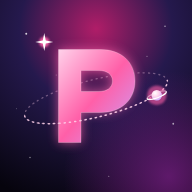
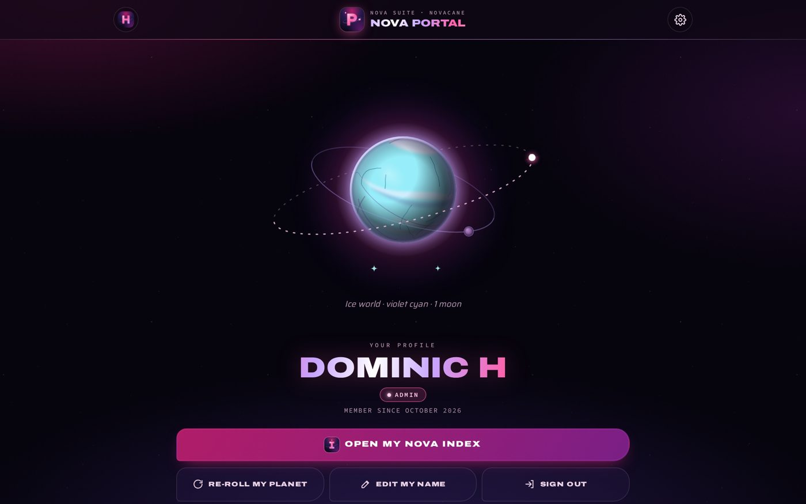
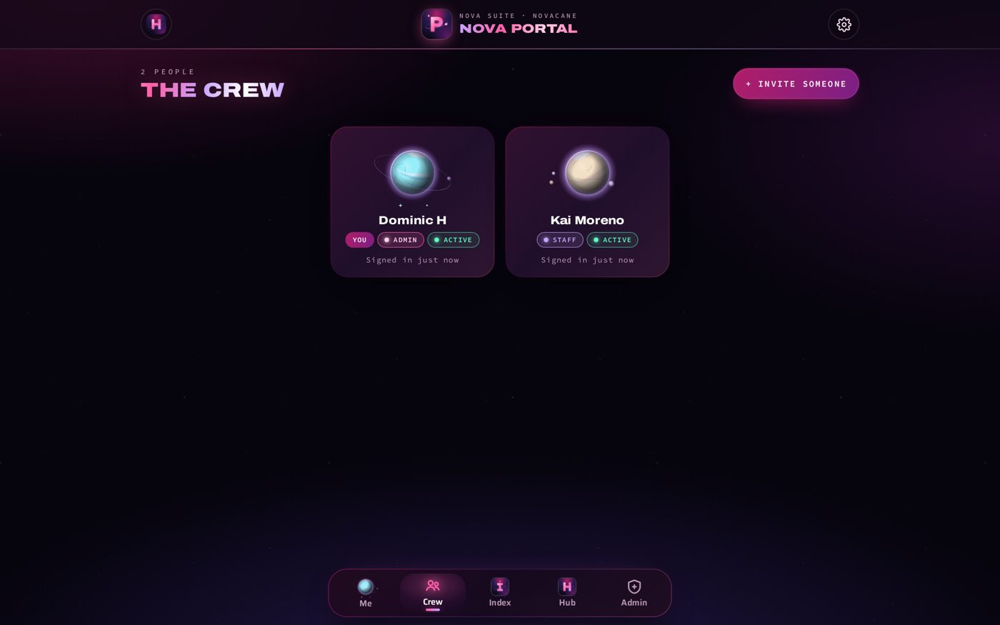

<p align="center"></p>

# Nova Portal

**One sign-in for the whole Nova suite, and a planet for everyone.** Part of the [Nova suite](https://github.com/tuniveza/nova-suite) for Novacane Studios.

Sign in once and you're signed in to Nova Hub, Nova Index and the admin pages. Every member of the team gets a unique planet, drawn from their id: their badge and their identity across the suite. Each planet is the face of that person's own partition of [Nova Index](https://github.com/tuniveza/nova-index), the suite's shared memory.

<p align="center"></p>

## What it does

- **Sign in once, everywhere:** email and password give you a secure session that Nova Hub, Nova Index and the admin pages all trust. Signing out (from any of them) ends it everywhere at once.
- **Setting up:** the first admin is created with the studio's current shared password, to prove it's you. After that, admins **invite** people with a link (valid for 7 days), and each person chooses their own password. Nobody else ever knows it.
- **Your profile:** your planet, big and animated, with your name, role and "member since". You can re-roll your planet (or go back to your original), change your name, and open your own Nova Index.
- **The crew (admins):** everyone as a planet badge, with their role, status and last sign-in. Invite people, change roles, switch accounts off (which signs them out at once), and send fresh invite links.
- **Roles:**
  - **Admins** see and manage everything, including customers' facts and approvals in Nova Index.
  - **Staff** see the studio's memory and their own partition.
- **Nova Club and other native apps** can sign in through the same API and get an app token instead of a cookie.

<table><tr>
<td width="50%"></td>
<td width="50%"></td>
</tr></table>

## The planets

<p align="center"></p>

`planet/` is a pure, deterministic generator: `generatePlanet(seed, theme, overrides?)` then `renderPlanetSVG(planet, { size, animate })`. The same seed and theme always give the same planet, so nothing is stored but the seed.

- **Kinds:** banded gas giants, cratered rocky worlds, ocean worlds with continents, molten worlds with glowing cracks, ice worlds, and ringed giants.
- **Details:** each has a palette drawn from the theme's ramps, an atmosphere glow, clouds or bands, and maybe rings (split properly in front of and behind the planet), up to three moons, an aurora or a storm.
- **A real sphere:** surface detail is projected onto it, with limb darkening, a terminator shadow and a specular highlight. Small badges simplify themselves, and the 512px hero animates.
- **Speed:** 1,000 planets generate and render in about half a second.
- **Themes hold all the art direction:** palettes, surfaces, glow, rings, moons, naming and the starfield. The Nova look lives in `planet/themes/nova.js`. When the studio's own lore is ready, it becomes a new theme file, with no change to the generator. A test proves it with a "lore" theme.
- **Porting:** `planet/README.md` documents the exact random number generator and draw order, so a Kotlin port (for Nova Club) draws identical planets.

## The API (on Nova Bot's worker)

| | |
|---|---|
| `POST /auth/login` | `{ email, password, client? }` → session cookie, or an app token with `client: "app"` |
| `POST /auth/logout` | ends this session everywhere |
| `GET /auth/me` · `GET /auth/status` | who's signed in · `{ setupNeeded, signedIn, staff }` |
| `POST /auth/setup` | the first admin (with the studio's current password) |
| `GET /auth/invite?token=` · `POST /auth/invite/accept` | accepting an invite |
| `GET /staff` · `POST /staff` · `POST /staff/:id/invite` | the crew, inviting, a fresh link (admins) |
| `GET /staff/:id` · `PATCH /staff/:id` | a profile; changing name, planet, role or status |
| `GET /staff/:id/planet.svg` | the planet badge (`?size=`, `?animate=1`) |
| `GET /staff/:id/index` | that person's Nova Index partition and the studio's shared facts |

- **Passwords:** PBKDF2-SHA256, salted, 100,000 rounds.
- **Sessions:** a random token in an httpOnly, Secure cookie. Only its hash is stored, and signing out deletes it.
- **Brute force:** sign-in, setup and invite attempts are rate limited.
- **Cross-site changes:** changes must come from the site itself.

The code is in [nova-bot](https://github.com/tuniveza/nova-bot) under `src/portal/`.

## Where it runs

`https://novacane-worker.novacane-studio.workers.dev/portal/`

This folder is the only real copy. Nova Bot copies `app/` to `public/portal/` and `planet/` to `src/portal/planet/` on every deploy and local run (`scripts/sync-apps.mjs`).

## Project layout

```
app/index.html, portal.js, portal.css   the Portal: setup, sign in, invites, profile, the crew, options
app/manifest.webmanifest, icon*         the installable app and its cosmic "P"
planet/generator.js                     the planet generator (pure; works in browsers, Workers and Node)
planet/themes/nova.js                   the Nova theme (swap in the studio's lore later)
planet/test.mjs                         determinism, every kind of planet, overrides, themes, well-formed SVG
planet/gallery.html                     48 planets, the hero and badges, for looking at
```

`node --test planet/test.mjs` runs the planet tests. Open `planet/gallery.html` through a local server to see them.

## Part of the Nova suite

[Nova Bot](https://github.com/tuniveza/nova-bot) · [Nova Agent](https://github.com/tuniveza/nova-agent) · [Nova Calendar](https://github.com/tuniveza/nova-calendar) · [Nova Notes](https://github.com/tuniveza/nova-notes) · [Nova Club](https://github.com/tuniveza/nova-club) · [Nova Observatory](https://github.com/tuniveza/nova-observatory) · [Nova Index](https://github.com/tuniveza/nova-index) · **Nova Portal**
