<div align="center">


# Nova Agent

**Your planner, your Agent and the studio's hands in Acuity, on the studio computer.**<br>
Talk to it, give it a goal, and it plans your days to the second. It also works Acuity's admin pages for Novacane Studios.

[](https://nodejs.org)
[](https://www.typescriptlang.org)
[](https://playwright.dev)
[](https://www.anthropic.com/claude)
[](deploy/agent-nova.service)
[](https://github.com/tuniveza/nova-bot)

</div>

---

Nova Agent is the studio's one app. Everything that used to be a separate Nova app is a
panel of it: **Portal** (the staff app: enquiries, website chats, bookings, alerts, Ask
NovaBot, sign-in, your planet and the team; Portal is part of it now), **Calendar**, **Notes**,
**Index**, **Observatory**, **Lossless audio** and **Admin**. The panels only ever open
inside Nova Agent. Nova Agent has one address, for everyone: <https://nova.novacane.co.uk/agent/>
(every address in the suite: Manual → All addresses, or Portal → Settings → Addresses).
It runs on the studio's server, so it works with every laptop off.

`/agent/<panel>` (`/agent/calendar`, `/agent/portal`, `/agent/notes`, `/agent/index`...)
opens Nova Agent with that panel. Nova Bot (the website chat) keeps the main address.

Agent, Missions, Quests, Calendar and the Visualizer run on the studio PC. The online Nova Agent
reaches them over a link the PC opens to Nova Bot (`src/relay.ts`, a WebSocket with
`AGENT_NOVA_KEY`), for signed-in staff only. When the PC is off, the online page says so and the
other panels keep working. On the PC itself, its pages open the online Nova Agent, so there's one
address; set `NOVA_LOCAL_UI=1` in `.env` to keep using the pages here (when the internet is down).

Open <https://nova.novacane.co.uk/agent/> and you get one screen that fits without
scrolling: **Missions** on the left, **Agent** in the middle, **Nova
Quests** (today's plan) on the right, and the **panels** along the bottom.

Behind Agent sits a planner: tell it a goal and it becomes a **Mission** of **Nova
Quests**, fitted around your sleep, your calendar and your travel, with reminders and
check-ins as you go. And behind that sits the job it started with: a careful, self-healing
browser helper that does what [Acuity Scheduling](https://acuityscheduling.com)'s API can't,
for [Nova Bot](https://github.com/tuniveza/nova-bot).

All the pictures here come from a separate sample copy with made-up quests and people.

## At a glance

| | |
|---|---|
| **Agent** | Claude, with tools for quests, missions, Calendar, Acuity (read-only) and its own status |
| **Missions and Quests** | Goals broken into quests, planned hour by hour (to the second), re-planned on every change |
| **Reminders** | Pop-ups, check-ins, a morning plan and evening wrap-up, chimes, system notifications and your phone |
| **Calendar** | Built in, saving to Nova Agent, so Agent and the calendar always agree |
| **Panels** | Portal, Calendar, Notes, Index, Observatory and Lossless audio, inside Nova Agent or in their own window |
| **Online** | The same Portal, Index, Calendar and Notes at Nova Bot's address (`/portal/` and so on), for the phones |
| **Index** | Reads what Nova Agent remembers before it replies, and learns after |
| **Acuity helper** | Changes session types, prices and paid status for Nova Bot, safely, healing itself when pages change |
| **Visualizer** | Every step the Acuity helper takes, live |

## See it work

<p align="center">
  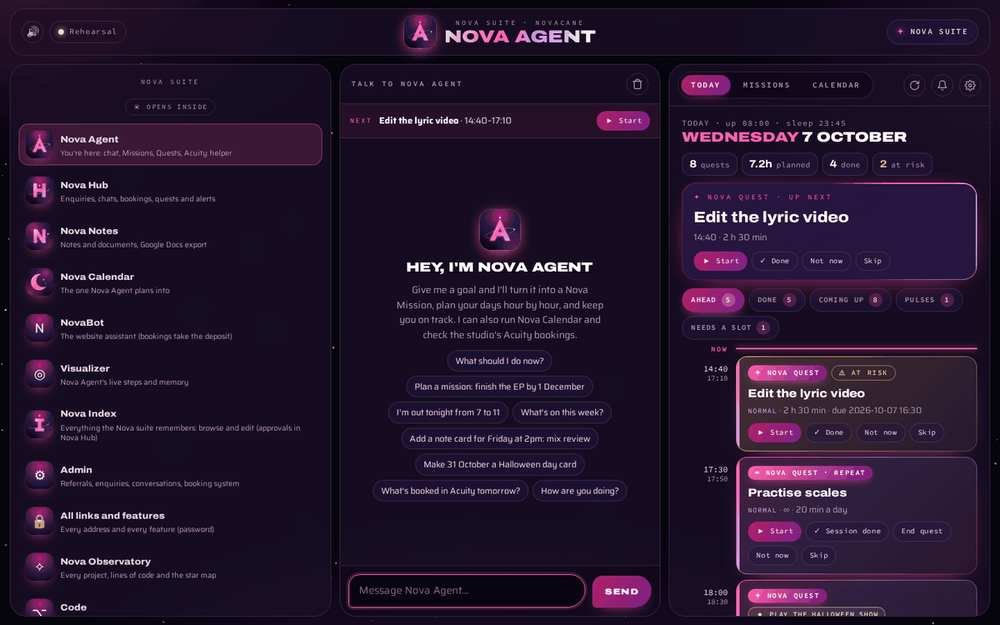<br>
  <sub>Ask for a quest, watch it land in the plan, then Start and Done.</sub>
</p>

<p align="center">
  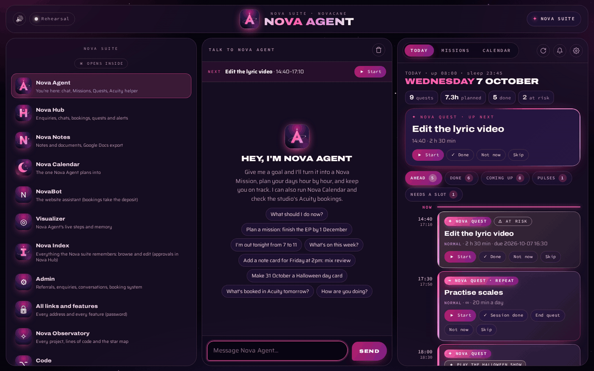<br>
  <sub>The rail opens Calendar, Notes and Index inside Nova Agent; "← Nova Agent" brings Agent back.</sub>
</p>

## The panels

| Panel | What it is | On the studio PC | Online (Nova Bot) | Code |
|---|---|---|---|---|
| **Agent** | Talk to Nova Agent; Missions and Quests | `/` | | `src/`, `web/agent/` |
| **Portal** | The staff app: enquiries, website chats, bookings, quests, alerts, Ask NovaBot, push to the phones, and sign-in, your planet, the team and invites | `/portal/` | `/portal/` | `web/portal/` |
| **Calendar** | Note cards and day cards; Nova Agent plans into it | `/calendar/` | `/calendar/` | `web/calendar/` |
| **Notes** | Notes and documents, Google Docs export | `/notes/` | `/notes/` | `web/notes/` |
| **Index** | Everything Nova Agent remembers: browse, edit, approve | `/app/memory/` | `/app/memory/` | `web/index/` |
| **Observatory** | Every project on this computer, measured and mapped | `/observatory/` | | `web/observatory/`, `scripts/observatory/` |
| **Lossless audio** | Raw PCM between two devices, anywhere | | its own address for now | `web/lossless/` |

What they share (themes, sounds, the badge, the Manual) is in `web/shared/`. Each
panel's guide is in `docs/apps/<panel>/`.

**Signing in on the PC.** Portal uses Nova Bot's staff API. Sign in on the Portal
panel and Nova Agent signs in to Nova Bot as you (an app sign-in; the token stays in
`data/signin.json` and never reaches the browser); after that the panels work with your
own permissions, and Nova Agent works for you. Only Nova Agent's own pages can use it.

**Online.** Nova Bot's worker copies the panels in at build time (its
`scripts/sync-apps.mjs`, from this repo's `web/`) and serves them for phones and anywhere
away from the studio PC. Portal's old address (`/app/`) opens Portal; its API (`/app/api/`),
Index (`/app/memory/`) and the push helper that phones which installed Portal still use
(`/app/sw.js`) keep their addresses.

## What it does

### Agent, in the middle

Agent (`src/chat.ts`) is Claude with tools. Ask it what to do next ("What should I
do now?" gives one clear recommendation), plan a mission, block out an evening ("I'm out tonight
from 7 to 11"), push your day back ("I'm running late"), add or change Calendar note
cards and day cards ("make 31 October a Halloween day card"), look at the studio's Acuity
bookings, check the Acuity login, research anything on the web (with links to where it came
from), look at any public webpage (it opens it in a browser of its own, never the Acuity one,
and sees a screenshot and the page's contents), or ask how Nova Agent is doing. Whatever it changes shows
up as a little chip under its reply, and the plan beside it redraws straight away.

On a wide screen the three columns sit side by side above Nova Agent, all on one screen; on
a phone or a very short window they stack (Agent first) and the page scrolls.

### Missions and Quests

<table>
  <tr>
    <td width="33%">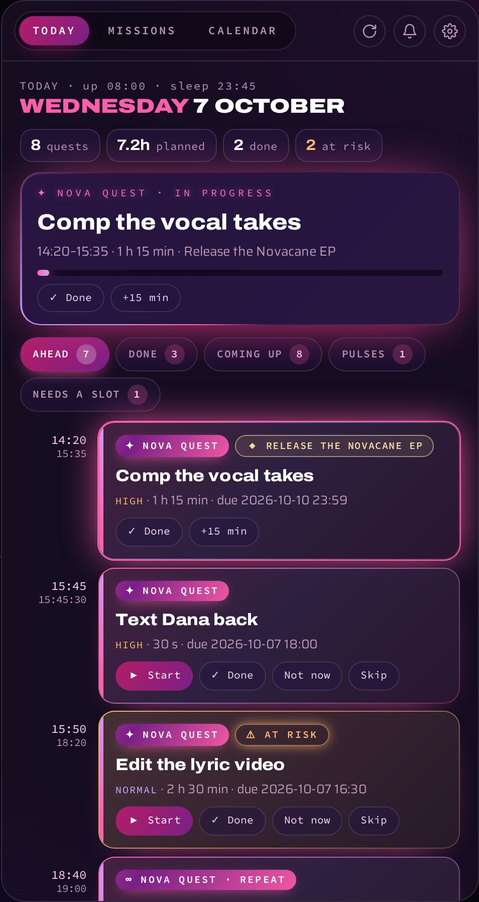</td>
    <td width="33%">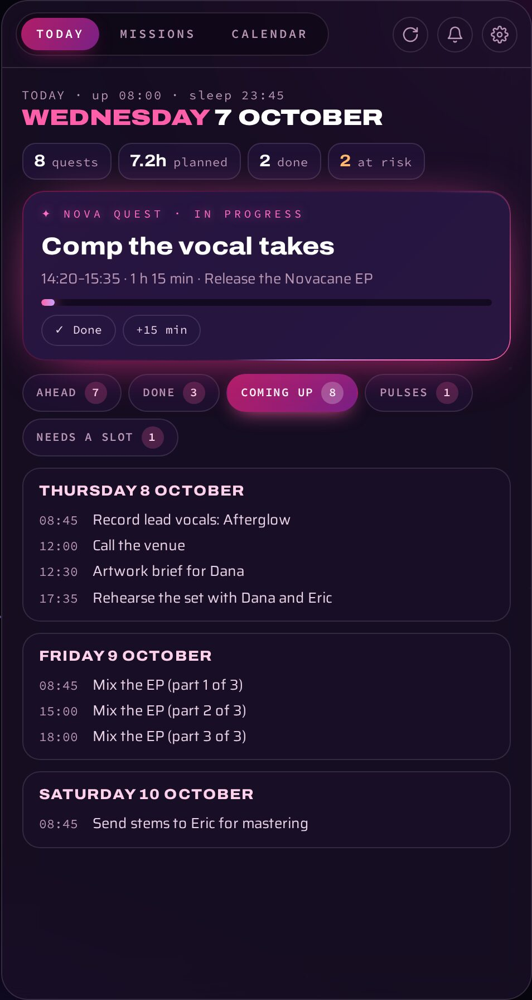</td>
    <td width="33%">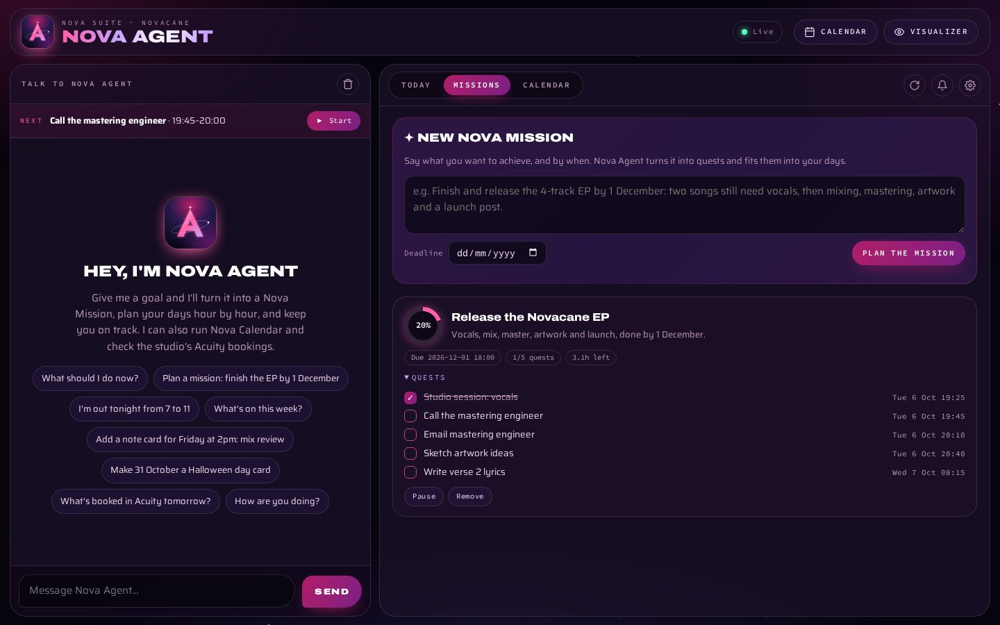</td>
  </tr>
  <tr>
    <td><sub><b>Today</b>: the now card, then Ahead, Done, Coming up, Pulses and Needs a slot.</sub></td>
    <td><sub><b>Coming up</b>: the next few days at a glance.</sub></td>
    <td><sub><b>Missions</b>: each one's progress ring and its quests.</sub></td>
  </tr>
</table>

Tell Nova Agent any goal, in the studio or anywhere in your life ("release the EP by 1
December", "I've fallen behind on my 52-release challenge and have two months left: I need a
content strategy, a release strategy and the quickest way to film and edit it all") and it
becomes a **Mission**. Claude (`src/quests/planner.ts`) writes:

- a **strategy**, in the sections the goal needs (release, content, production, filming and
  editing, a typical week, how to catch up), with the maths done;
- **tracks** (workstreams such as Music, Content, Release, Gear), each with its own colour and
  progress bar;
- dated **milestones**, which also appear in Calendar as ◆ cards;
- **Quests**, each with a length, a priority, a deadline, what it waits for, where it happens and
  the travel to get there. Work that repeats per item (every song's finish → mix → film → edit →
  post) is described once as a **series** and written out here with exact spacing;
- the **assumptions** it made and the **questions** that would sharpen it. Answer them in the
  mission's **Refine** tab (or just tell Agent) and the work that's left is planned again;
- **research**: when current facts would make the plan better (how a platform works now,
  distributor lead times, prices, opening hours), it searches the web and reads pages while it
  plans. What it used is listed under "Researched on the web" in the mission's Plan tab, each
  with a link, and only pages it really read are kept.

Tap a mission to open its plan: **Plan** (tracks and strategy), **Roadmap** (milestones by
month, tick them off), **Quests** (by week, filtered by track) and **Refine**.

As you type to Agent, a **cue** above the box shows what the message will become (Nova
Mission, Quest, repeating quest, pulse, blocked time, quest update, mission detail,
calendar card, studio bookings or a question) and what it picked out (deadline, time, length,
how often, how many, platforms).

Then a planner with no AI in it (`src/quests/scheduler.ts`) fits every quest into your days:

- around your **rhythm**: get up, a start-up time, wind-down and bedtime, a buffer between
  quests, a proper break after long ones, a cap on quest hours per day, and **days off** with
  no quests at all (the ⚙ button; say "I can't work Sundays" and the planner sets it);
- around Calendar entries and any **blocked time**;
- most urgent first (the least slack between when it may start and its deadline, weighted by
  priority), never before the quests it depends on, in the part of the day it suits;
- as far ahead as the furthest deadline needs (up to a year), not just the rhythm's
  "plan ahead" days;
- with **travel time** in front of anything somewhere else, and a "leave by" reminder;
- flagging anything that can't make its deadline as **at risk**, and anything that can't be
  placed at all under **Needs a slot**, with the reason.

**Any length, from a second to forever** (`src/quests/lengths.ts`):

| Kind | Example | How it's planned |
|---|---|---|
| Seconds | "Text Dana back", 30 s | Placed to the second; quick ones go back to back |
| Hours | "Comp the vocal takes", 1 h 15 min | One slot |
| Long work | "Mix the EP", 8 h | Split into sessions of up to 3 hours ("part 2 of 3"), in order |
| Ongoing | "Practise scales", 20 min a day | A session every day, weekday, week or any interval, until you end it or its deadline passes |
| Pulse | "Drink some water", every 2 min | Repeats faster than every 5 minutes run on their own exact timer (down to every second), only while you're awake, without taking slots in the plan |

**Pace limits** (in the rhythm) are the safety switch: on, quests start a few minutes from now,
on 5-minute marks, with buffers and breaks; off, they can start right now, to the second,
back to back.

It **re-plans on every change**: finish early and the rest moves up, press Not now and it finds
a new slot, and a quest left unanswered an hour after its end is moved and you're told where.
Missions can be paused, resumed or removed, and a mission finishes itself when its last quest
is done.

### Reminders, check-ins and chimes

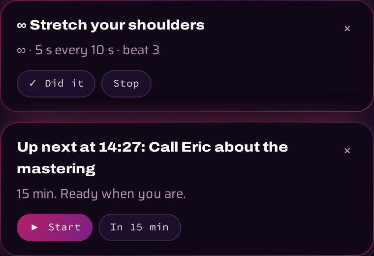

Checked every 10 seconds (`src/quests/reminders.ts`):

- a **reminder** before each quest (or before you need to leave), with Start and In 15 min;
- a **check-in** when it should be finished: Done, +15 min or Move it;
- a **morning plan** and an **evening wrap-up**;
- each **pulse** as one ticking card that counts its beats, instead of a pile of pop-ups.

Each kind has its own bright **chime**, made live in the browser. Press 🔔 for **system
notifications**, which arrive even with Nova Agent in the background and bring it back when
clicked. With the rhythm's phone setting on, they also go to the **your phone**, where Nova
Agent, Quest and Mission alerts each have their own label, check-ins stay on screen
until they're answered, and a pulse replaces its last notification.

<br clear="right">

### Quests on the phones

Nova Agent sends its plan (missions, quests, pulses, and Calendar's note and day cards)
to Nova Bot's worker whenever it changes, and every minute so "now" keeps moving
(`src/quests/portalsync.ts`). Portal's Quests and Calendar tabs show it on the staff phones,
and taps made there (Done, Start, Not now, Skip, pause a mission) come back with each job
check and are carried out within about a second.

### Calendar, built in

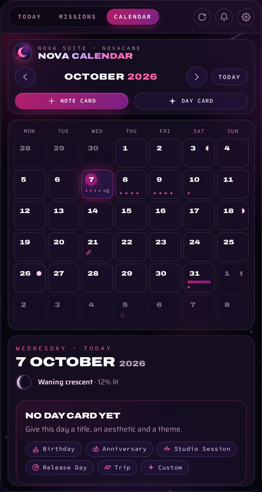

Calendar is a panel (`web/calendar/`) served at `/calendar/`. Inside Nova Agent it saves to `data/calendar.json`
instead of only the browser, so Agent, the planner and the calendar always see the same
note cards and day cards. Every planned quest and blocked time shows up in it as a note card
(✦ for a quest, ∞ for a repeat, ⚠ when at risk, ✓ when done), and its theme colours the whole
of Nova Agent. The **Calendar** tab fits it to the plan column with no scrolling.

<br clear="right">

### The Nova Agent, inside or in a window

<table>
  <tr>
    <td width="42%">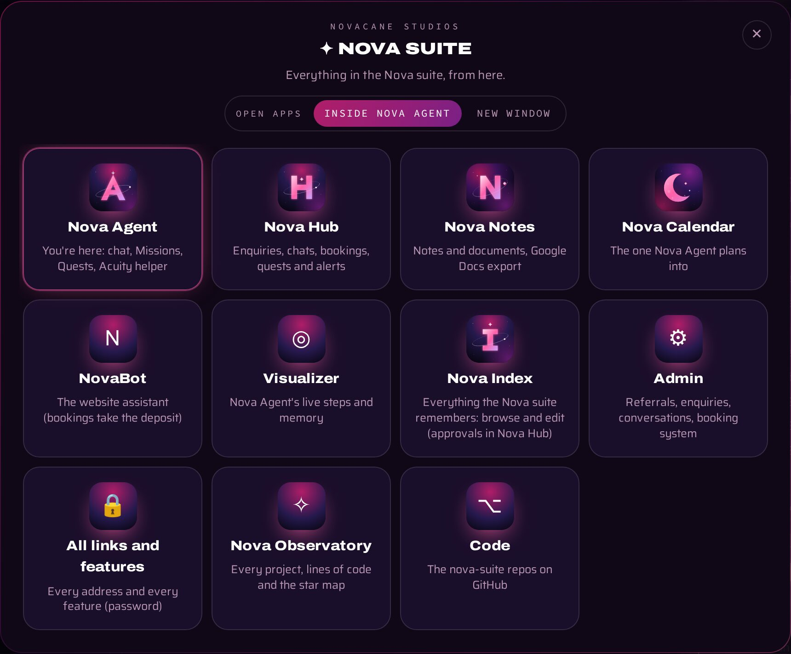</td>
    <td width="58%">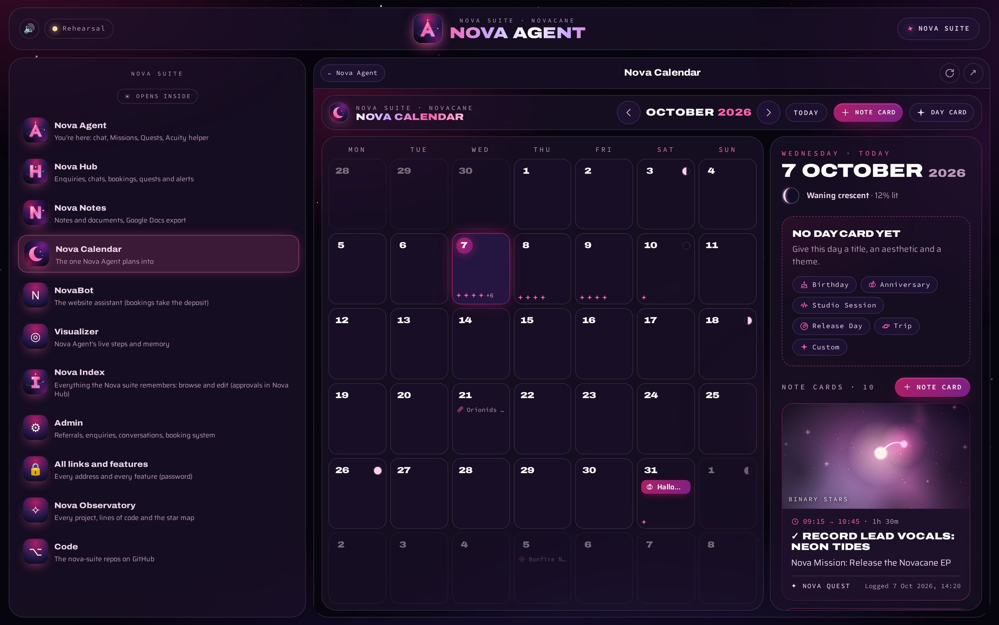</td>
  </tr>
  <tr>
    <td><sub>The <b>✦ Nova Agent</b> launcher, with the "Open apps" switch.</sub></td>
    <td><sub>Calendar opened inside Nova Agent from the rail.</sub></td>
  </tr>
</table>

The rail down the left (and the ✦ Nova Agent launcher) holds every Nova app: Portal,
Notes, Calendar, Nova Bot, the visualizer, Index, Admin, all links and features,
Observatory and the code. One switch decides where they open:

- **Inside Nova Agent**: the app takes the middle of the screen, with "← Nova Agent", reload
  and "↗ open in its own window" above it. Nova Agent serves Calendar, Notes
  (`/notes/`), Observatory (`/observatory/`) and Index (`/app/memory/`) itself, from
  the folders next to it, so they open inside in any browser.
- **New window**: each app in its own tab or window.

Admin and the links page always get their own window: they refuse to be shown
inside other pages, which keeps their sign-in safe, and Nova Agent says so once.

### Sound effects

Novacane's soft glass tones, warm under-tones and breaths of air for every tap, tab, switch,
open, close, send, done and delete, made live with the Web Audio API (no sound files). Ambient,
not beeps: everything swells in, chords bloom together rather than running up like a game, and a
tap is a low felt touch. They're in D lydian, the same key as the ambient music, so the two always
sound right together; they're placed across left and right and washed in a little reverb and
echo, and kept quiet: calm, relaxing and lush, never loud or chatty. Every sound swells in slowly,
with a warm, soft top end and plenty of space; never more than three notes at once; the small
sounds (taps, tabs, menus) keep well apart and the same one doesn't come straight back.

**Quiet extras**, barely there and with their own switch (Portal → Options → Quiet extras, or on
a phone the gear → Quiet extras): a breath of air as you scroll (quieter the slower you go, a few
times a second at most), the softest touch per key when typing in a box, tones that rise and fall
as you drag a slider, a sound when you pick up and put down something you drag (Calendar's note
cards, with a tiny tick at each step), and an extra-faint shimmer as the mouse arrives on a tile.
They're off to begin with (calm first) and only heard while sound effects are on. Nova Agent
chimes when it answers, and a short "hello" (D–A–C♯–F♯) plays when sounds are switched on. The 🔊
switch at the top left turns them off (on a phone: the gear → Sound), and the choice is remembered
on that device. It's the same `web/shared/sfx.js` in every panel.

**Every panel sounds like itself**, all in the same key: Notes is paper and pencil, Calendar soft
clock ticks and chimes, Portal deep and roomy like its planet, Index droplets that echo away,
Observatory the wide night sky, Lossless audio a soft electric piano, Visualizer glass glints,
Quests a warm kalimba and Missions a low, steady swell. A button that opens a panel sounds like
that panel. Different kinds of things have their own sounds (switches, tick boxes, menus, lists,
links, tabs…), each button has its own notes, and no sound plays exactly the same way twice
running, so they never get too familiar. When sounds come thick and fast they get softer by
themselves, and come back after a pause.

### The panels bar and motion

It shows and hides itself (**Auto**, the default): always there on Nova Agent's home. With a
panel open it follows what you do, not timers: on a computer it's in view while the mouse is near
the bottom and steps aside once you work higher up in the panel; on a phone it steps aside when you
scroll down a good way on purpose and comes back as soon as you scroll up a little or tap the
little handle at the bottom (pages that hardly scroll never hide it). With a mouse, scrolling down
in a panel sends it away too (unless the mouse is on it).

Over an open panel the bars float and only slide: in over 0.18 s, away in 0.15 s, moving as one
piece. The panel never changes size when they come and go, so nothing in it jumps or reflows
(checked by `node scripts/check-bars.mjs <address>`, which opens a panel at computer, tablet and
phone sizes, brings the bars in and out, and fails if the panel moves, a move is set longer than
0.2 s, or the two top bars differ). On the home, typing no longer hides the bar, so the page stays
put. On a tablet or a phone on its side the bar is one row, each group as wide as its places and
their names need (`--tg-cols`, set by `phone.js`), so no name is squeezed or cut.

Each panel's icon is from one line-art set, in its own colour (Notes amber, Calendar moon-violet,
Index teal…) blended with the theme's accent, so the icons change with the theme and still keep
their own mood. It can also be **Always shown** or **Always hidden**: choose in
the Panels window (the PANELS button) or on a phone in the gear (Bar). Remembered on the device
(`web/agent/assets/bar.js` and `bar.css`).

Along the bottom on a computer: every panel in its four groups (Apps, Tasks, Tools, Helpers),
edge to edge. It's the same bar whatever is open; with a panel open it only gets smaller. Motion
is light (only scale and opacity move): buttons and tiles press in softly, the open panel's tile
breathes, and panels fade in as they open (`web/shared/inside.js`, and Calendar's `embed.js`).
It all stops when the device asks for less motion or Portal's Options → Animations is off.

### One look, the top bar, and the status line

**One theme for everything:** in the Panels window (the gear at the top; on a phone the
phone's gear → Theme & look) pick a theme (Novacane, Solar Flare, Pulsar, Aurora, Eclipse, Quasar
or Mono) and every app, task, tool and helper wears it, whatever its own theme setting; "Each
panel's own" goes back to each panel's own. **Colour everything from my planet** tints it all
with the colours of your planet in Portal (Nova Bot sends them with who you are). Saved on the
device; every open panel follows at once (`web/shared/look.js`, loaded first in every panel).
With both on, the planet keeps its look (its dark backgrounds and soft light) and the colour you
picked takes the buttons, glows and highlights, so every colour choice clearly shows: Pulsar gives
cyan, Aurora green and violet, Eclipse gold. With "Each panel's own", the planet colours everything
as before.

**One top bar:** Nova Agent's header (`web/shared/topbar.css`, class `nv-topbar`: a glass capsule
with the glowing edge). With a panel open (an app, a plan, a tool or a helper) there's no second
bar: the header itself becomes that panel's slim **title panel** (48px on a computer, 44px on a
phone): ← back, the panel's icon and name (tap it to switch panels) and Reload, with Nova Agent's
own controls right there in it: sound, music, Live, the planet (sign in and out, your Portal
account), Install, Panels and the gear. It stays as wide as the header is on the home, so the panel
below starts in the same place. On a narrow phone Live shows as its coloured dot. The panel sits in
its own box under it (`#viewer-body`). Index and Quests don't repeat their names under it.

**The bars are always shown** (the old Auto, which hid them while you scrolled, is gone: it made
Nova feel laggy). Always hidden is still a choice in the Panels window, for the panels bar and the
top bar.

**The status line** is the bottom row of the navigation bar, inside its frame, below the icons
(the panels strip on a computer, the bar on a phone), on the home and with any panel open: the
version and build, the latest change in a few still words (for the group or panel you point at,
or the one that's open), when you came on and were last off, what you've done lately (tap it for
the list), the date ("Mon 12 Oct") and a 12-hour clock (`web/agent/assets/status.js`; the words
come from `web/shared/status-data.js`, made by `npm run status`, which `npm run manual` runs too).
Every part shows; when the bar is narrower than the line it wraps onto a second row. Always hidden
hides it everywhere; each part (the date too) can be switched off in the Panels window.

**The icons** are little glowing scenes of space, each on its own small Novacane nebula (its own
colour mixed with the theme's): the Novacane sigil in an orbiting orb (Agent), a ringed planet and
its moon (Portal), the moon over its phases (Calendar), a quill writing a constellation (Notes), a
glowing star cluster (Index), a comet streaking to a star flag (Quests), a rocket (Missions), a
pulsar (Lossless audio), a spiral galaxy (Visualizer), a domed observatory under the moon
(Observatory) and a star atlas (Manual). The panels bar itself is a strip of night sky: nebula
light in the theme's colours, faint stars, the sigil softly in the corner, a glowing edge and
shimmering group names; its tiles sit right on the sky (no boxes), with a soft glow behind the one
you point at and a line of light under the open one. The same glowing edge and nebula light are
on the top bar, the columns, an open panel's frame, the pop-up windows and the status line, and
every button, tab and box (in the panels too) glows the same way when you're on it (`glow.css`).
On a computer the top bar, the panels bar and the status line are only as wide as what's in them.
**Centred text:** all text in Nova Agent and its panels is centred (Panels window → Centre all
text switches it off); what you write in a Notes document, and code, keep their own alignment. It comes and goes with a quick spring, its tiles popping
in one after another. The gear (settings) is on computers too: it opens the Panels window.

### The latest polish

- The panels bar is smaller, with each group's name centred between two fine lines of light.
- The status line is plain words with small icons: the version, what's new ("Calendar: note cards
  back"), "Here since …", "Last left …", what you did last ("Opened Notes · 2 min ago": tap for the
  list) and the day and time.
- The two settings buttons look different: sliders at the top for Look & layout (theme, bars,
  text), and the sun and moon over the horizon on Quests for your daily rhythm.
- Quests fits more on one screen: the next thing is a full card, the rest slim one-line rows
  (time and title) that open on a tap.
- Scrollbars everywhere are slim, rounded and glowing in the theme's colours, with soft sounds
  when you take hold of one, as you drag it (a tone that follows where you are) and let go.
- The sky behind Nova Agent is a deep nebula with a faint band of the galaxy and far galaxies, and
  it takes on the colour of the app that's open, slowly.
- The columns' titles are centred, and so is the conversation (every message in the middle).

### Every window size

Nova Agent fits whatever size its window is: computer windows down to 481px tall keep the
computer layout, getting tighter as they get shorter (a slimmer header, Agent's suggestions in
one row you swipe, smaller bars); narrower computer windows get slimmer side columns and smaller
buttons; tablets and windows between phone and computer size get the bar in one centred row; and
phones keep their own layout. In Auto, the mouse anywhere in the lower part of the window (its
bottom 14%) brings the panels bar up. Inside Nova Agent, Notes never runs off the screen: its
toolbar wraps, and the page starts as tall as the window.

### Today in music (the front page)

Under the welcome, until you start talking to Agent: small cards, a line or two each. The **Top 10
worldwide** (live: the songs most played on Apple Music across 12 countries, via Nova Bot's
/music-world, kept 6 hours), **popular genres**, **budget gear** (what each does, rough price),
the **music industry** (IFPI Global Music Report 2026: $31.7bn in 2025, up 6.4%), a musician's
**quote of the day** with their picture (from Wikipedia; "attributed" when its origin isn't
certain) and a **song of the day** (named and described, with a link to its lyrics: lyrics
themselves are copyrighted). A tap on a card opens a short list. Data: `web/agent/assets/music-data.js`.

### Phones and tablets

Nova Agent knows when it's on a phone or a tablet from the device itself (iPads included), not
just the window's size (`look.js` puts is-touch / is-phone / is-tablet on every page). There it's
made for fingers and kept light: bigger tap targets, no zoom when you tap into a box, nothing that
needs a mouse, no frosted-glass blur or drifting sky. On a tablet showing the computer layout the
bars hide and show with your swipes and a handle brings them back. The conversation's pages turn
with a sideways swipe (`web/agent/assets/touch.css`).

### Install or remove the apps (and help)

An **App** button (the phone with an arrow, in the top bar of Nova Agent and of the Portal app,
on Portal's sign-in screen, in the phone's gear menu and in the Panels window) opens one sheet:
Nova Agent and Portal, each with **Install** and **Remove**, and the steps for exactly this device
(it reads iPhone or iPad and its iOS version, Android phone or tablet and its version, and the
browser). Android and computers get a real one-tap install when the browser offers it; iPhone and
iPad can't be installed by a website, so it shows Safari's two taps. **Remove** wipes the app
from the device (notifications off, signed out, saved data and offline files gone; shared notes
and everything online stay safe), then shows the one step that deletes its icon. **Something not
working?** covers the in-between problems: installed but can't find it, no install option, opens
in the browser, no notifications, an old name or picture, signing in again, two copies, stuck or
out of date, or a phone too old (`web/shared/install.js`, `install.css`).

### Updates arrive by themselves

Phones don't reload an app from the home screen: they wake the copy still in memory. So Nova
Agent and the Portal app ask Nova Bot which version is live (`/app-version`, new with every deploy)
whenever they're opened or come back to the front, and every 10 minutes while on screen; when it's
new they refresh themselves (waiting while you type or have a window open), then say "Updated ✦"
(`web/shared/update.js`). A new name or icon still needs the app re-added on iPhone and iPad (Apple
never updates those); Android updates them by itself within about a day.

### Ambient music

Quiet, never-ending Novacane ambient music: slow warm pads, a soft bass, star-like bells, now and
then a short soft electric-piano phrase, and a faint ocean of air, all made live (no sound files,
nothing downloaded) by `web/shared/ambient.js`. It's off until you switch it on with the ♫ switch
at the top left (on a phone: the gear → Music; in Portal: its music button). There's one player
for the whole app, in Nova Agent's main page, so it carries on while panels open and close, and
every switch shows the same state. On or off is remembered on the device: when it was on, it
starts again on your first tap (browsers only allow sound after a tap). The volume is Portal's
Options → Ambient music volume.

Coming next: music with bass and melody, seven moods.

### Index: it remembers

Before each reply and each mission plan, Nova Agent asks Index
(the suite's shared memory, on Nova Bot's worker) for the few facts that matter: the studio's,
and those of the person Nova Agent works for (found by itself: see below). The read is quick (a short
timeout and a 30-second cache) and never holds a reply up for long. After each conversation,
the exchange is handed back to be learned from, in the background (`src/memory.ts`). It reads
studio and staff memory only, never customers'.

Index itself opens inside Nova Agent from the rail, through Nova Agent's own key:
you can browse and edit the studio's and staff memory there, while approvals of customers'
facts stay behind a Portal sign-in. Without `AGENT_NOVA_KEY`, memory is simply switched off.

### The Acuity helper

The job Nova Agent was built for. It drives Acuity's admin pages in a real Chromium, the way a
person would, for the jobs Acuity's API can't do.

- **Jobs from Nova Bot** (`src/jobs.ts`): it waits on the worker for jobs and picks each one up
  within about a second. Today that's `change` jobs (staff asked in Portal to change a
  booking's session type, price or paid status); it does them in Acuity, checks the result and
  reports back to staff phones. Customer bookings go through Acuity's own booking page, so the
  deposit is always paid first; `book` jobs are still understood here.
- **Logs itself in** and saves the session; logs back in when it expires.
- **Self-healing element finder** (`src/heal/`): every task says *what* it wants ("the Cancel
  Appointment button"), never *how* to find it. `resolve()` tries the selector memory first
  (instant and free), then asks Claude, checks the answer against the page, and remembers it.
- **Appointment actions** (`src/acuity/`) from the command line: list, search, book, cancel,
  edit and reschedule.
- **Safety first**: a dry-run mode that stops before every final click, a second layer that
  refuses any change-making request, exact-match rules for cancel and edit, and a read-only
  healthcheck every morning. See [Safety](#safety).

### The visualizer

<table>
  <tr>
    <td width="50%">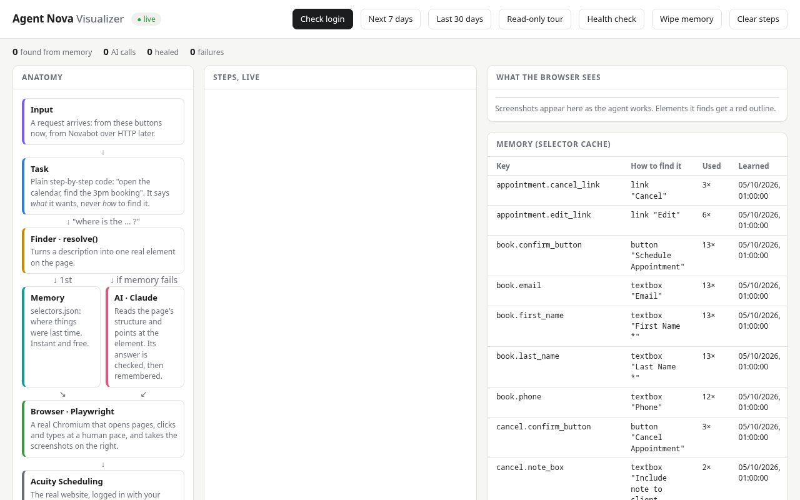<br><sub>Anatomy, live steps, what the browser sees and the selector memory.</sub></td>
    <td width="50%">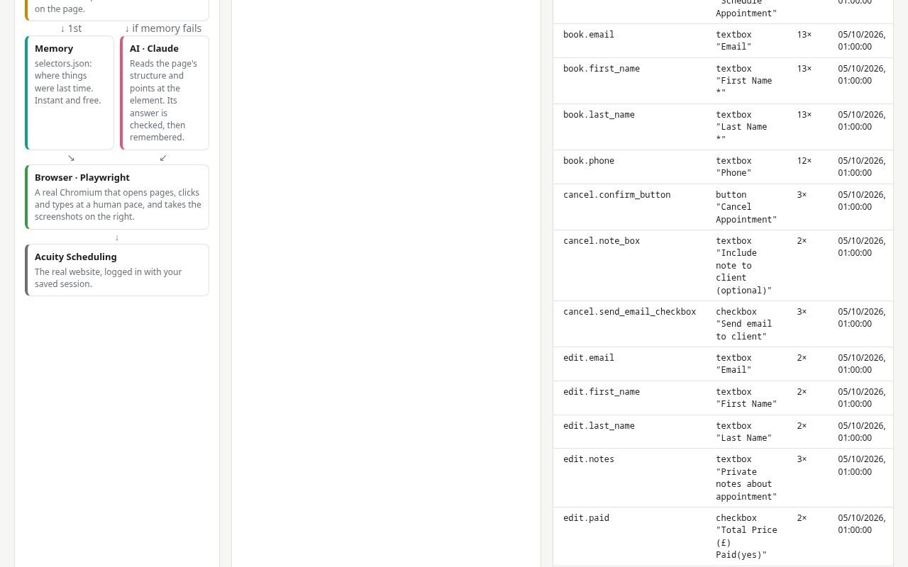<br><sub>Where the agent last found each element, and how often.</sub></td>
  </tr>
</table>

`/visualizer` shows the Acuity helper at work: its anatomy, every step in plain English, what
the browser sees, and its memory. Its buttons only ever run read-only tasks (check the login,
the next 7 or last 30 days, a read-only tour, the healthcheck), and **Wipe memory** lets you
watch it heal again. These screenshots are of an idle visualizer: at work it shows real
Acuity pages and client names, which is why Nova Agent only ever listens on `127.0.0.1`.

### An app for your launcher

Open <https://nova.novacane.co.uk/agent/> (on a phone: Share → Add to Home
Screen) and press **Install app**: Nova Agent opens
in its own window, with shortcuts to Today, a new mission, Calendar and the visualizer.
Its service worker shows reminders as system notifications; nothing is cached, because Nova
Agent is its own server on the same machine.

## How it works

```mermaid
flowchart LR
    You[You, at the studio PC] --> UI[Nova Agent page<br/>Agent · plan · suite]
    UI --> Chat[Agent<br/>src/chat.ts] --> Claude[Claude]
    Chat --> Q[(Quests and calendar<br/>data/)]
    UI --> Q
    Chat <-->|reads before, learns after| NI[Index<br/>on Nova Bot's worker]
    Q -->|plan, reminders| Phone[your phone]
    S[Staff in Portal] --> NB[Nova Bot Worker]
    NB -->|queues jobs| J[(agent_jobs)]
    NA[Acuity helper] -->|"any jobs?" long-poll| J
    NA --> R[resolve&#40;&#41;] -->|1st| M[(Selector memory)]
    R -->|if memory fails| Claude
    NA --> B[Playwright Chromium] --> A[Acuity admin pages]
    NA -->|result| NB
```

- **No open ports.** Nova Agent only listens on `127.0.0.1` and only calls out to the worker,
  so it runs on any always-on computer.
- **Limits.** `BOOKINGS_PER_VISITOR_PER_DAY` (default 2) is sent to the worker each time Nova
  Agent checks in.
- **Notes on Acuity's real pages** (addresses, buttons, forms, and the safety finding that
  cancelling is a plain GET) are in [docs/acuity-ui-notes.md](docs/acuity-ui-notes.md). Read it
  before changing cancel, book or edit.

## Run it locally

You need Node 22 or newer. Acuity is only needed for the Acuity helper, and only with an
account you're allowed to automate.

```sh
git clone --recurse-submodules https://github.com/tuniveza/nova-agent.git
cd nova-agent             # (already cloned? git submodule update --init  brings in calendar/)
npm install
npx playwright install chromium
cp .env.example .env      # then fill it in
npm run visualizer        # http://localhost:4545/agent/
npm run login             # for the Acuity helper: log in once in a visible browser window
npm start                 # should say "Logged in to Acuity"
```

Agent and mission planning need `ANTHROPIC_API_KEY` in `.env` (Claude also powers the
self-healing element finder). Jobs, phone alerts, the phones' Quests sync and Index memory need
`AGENT_NOVA_KEY`; without it they're simply off. To bring the calendar up to date with its own
repo: `git submodule update --remote calendar`.

Observatory, Notes and Index open inside Nova Agent when their repos sit next
to this one (`../no`, `../nn`, `../ni`).

`DRY_RUN=true` is the default in `.env.example`, so book, cancel and edit stop before the
final click until you decide otherwise.

### A second copy with sample data

`NOVA_DATA_DIR` points Nova Agent at another data folder, so a preview or a screenshots copy
never touches the real quests, calendar or Acuity session:

```sh
NOVA_DATA_DIR=/tmp/nova-sample AGENT_NOVA_KEY= DRY_RUN=true VISUALIZER_PORT=4547 npm run visualizer
```

With `AGENT_NOVA_KEY` empty it won't collect jobs, read memory or send phone alerts.

### Commands

| Command | What it does |
|---|---|
| `npm run visualizer` | Nova Agent itself: Agent and plan at http://localhost:4545, reminders, the phones' Quests sync, the daily healthcheck and job collection (`npm run service` is the same) |
| `npm start` | Checks the Acuity login; logs in automatically if the session expired |
| `npm run login` | Opens a visible browser so you can log in to Acuity by hand |
| `npm run list` | Appointments for the next 7 days |
| `npm run list -- 2026-09-01 2026-09-30` | Appointments between two dates |
| `npm run search -- name=Kai` | Search; also `type=`, `email=`, `phone=`, `from=`, `to=` (default: today to 60 days ahead) |
| `npm run book -- "type=..." date=... time=... first=... last=... email=...` | Book (stops before the final click if `DRY_RUN=true`) |
| `npm run cancel -- date=... time=... "name=..." [notify=no]` | Cancel (same safety) |
| `npm run edit -- date=... time=... "name=..." [phone= email= first= last= type= notes= newdate= newtime=]` | Edit and/or reschedule (same safety) |
| `npm run healthcheck` | Read-only check that every Acuity page and button can still be found |
| `npm run typecheck` | Checks the code for type errors |

### Running it all the time

`deploy/agent-nova.service` is a systemd **user** service that runs Nova Agent (the page,
reminders, the daily healthcheck and job collection), starts when you log in, and restarts if
it crashes. Edit its `WorkingDirectory` to where you cloned the repo, then:

```sh
cp deploy/agent-nova.service ~/.config/systemd/user/
systemctl --user daemon-reload
systemctl --user enable --now agent-nova
journalctl --user -u agent-nova -f      # its log
systemctl --user restart agent-nova     # after changing .env or code
loginctl enable-linger $USER            # keep it running when logged out
```

On a server with no screen, `npm run login` won't work; with `ACUITY_EMAIL` and
`ACUITY_PASSWORD` set, the agent logs itself in instead. View it through an SSH tunnel:
`ssh -L 4545:localhost:4545 your-server`.

## Configuration

All settings come from `.env` (copy `.env.example`); variables already set in the shell win.
Names only here; never commit `.env`.

| Name | Default | What it's for |
|---|---|---|
| `ANTHROPIC_API_KEY` | – | Agent, mission planning and the AI element finder |
| `NOVA_MODEL` | `claude-opus-5-5` | The Claude model name |
| `NOVA_WORKER_URL` | Novacane's worker | Nova Bot's worker: jobs, alerts, the phones' Quests sync and Index |
| `AGENT_NOVA_KEY` | – | Must match the worker's `AGENT_NOVA_KEY` secret; blank = no jobs, phone alerts, Quests sync or memory |
| `NOVA_STAFF_ID` | *(found by itself)* | Only to force who Nova Agent works for. Without it, Nova Agent picks the studio's first Portal admin, and anyone can switch it to themselves with **Connect as me** on the Nova Agent badge (kept in `data/staff.json`) |
| `NOVA_DATA_DIR` | `data/` | Where everything is kept; point a second copy somewhere else |
| `ACUITY_EMAIL`, `ACUITY_PASSWORD` | – | Automatic re-login |
| `ACUITY_ADMIN_URL` | Acuity's appointments page | The page used to check the login |
| `ACUITY_TIMEZONE` | `Europe/London` | The business's timezone; "today" is worked out in it |
| `JOBS_EVERY_SECONDS` | `10` | How long to wait before asking again if the worker answers at once |
| `ACTION_PAUSE_MS` | `150` | Longest human-like pause before each click or typed box (0 = flat out) |
| `BOOKINGS_PER_VISITOR_PER_DAY` | `2` | A number, or `unlimited` |
| `HEALTHCHECK_CRON` | `0 6 * * *` | When the read-only healthcheck runs (UK time) |
| `VISUALIZER_PORT` | `4545` | Nova Agent's page |
| `HEADLESS` | `true` | Show the browser or not |
| `DRY_RUN` | `true` | Stop before every final click (the status pill says **Rehearsal**) |
| `NOTIFY_CLIENTS` | `true` | Tick Acuity's "Send email to client" when cancelling |

Your rhythm (wake, sleep, buffers, breaks, the daily cap, reminders, check-ins, briefings, phone
alerts and pace limits) is set on the page with ⚙, or by asking Agent.

Everything Nova Agent writes at run time goes in `data/` (or `NOVA_DATA_DIR`), which git
ignores: quests and missions (`quests.json`), the calendar (`calendar.json`), the saved Acuity
session (`session.json`, which works like a password), the selector memory, the healthcheck
result, screenshots, daily logs (`logs/<date>.jsonl`, which include client names) and
`alerts.log`.

## Safety

- **Dry run** (`DRY_RUN=true`): book, cancel and edit stop before the final click. As a second
  layer, the browser refuses any request that could change something in Acuity. Acuity's
  cancel is a plain GET, so this also blocks anything carrying Acuity's `__csrf_magic` change
  token.
- **The healthcheck** always runs with that second layer on, even when live.
- **Cancel and edit** need an exact date and time match (and the client's name if given). If
  more than one appointment matches, the agent refuses.
- **Agent is read-only in Acuity**: it can look at bookings and check the login, never book,
  move or cancel.
- **The page's buttons** only work from the page itself (a custom header other websites can't
  send), and Nova Agent only listens on this computer.
- **Alerts** (login problems, failed healthchecks) go to the console, `data/alerts.log`, and
  staff phones through the worker when `AGENT_NOVA_KEY` is set. Repeats are held back for six
  hours.

## Tests

`npm test` runs the Quest reminders on a simulated clock (Vitest fake timers, a pretend
Nova Bot worker and a throwaway data folder: `test/harness.ts`): a reminder every 30 minutes
for 4 hours pings exactly 8 times, a ping the worker turns away is retried, Nova Agent being
off across a session gives one late "Missed" ping, no session is moved past without a
delivery record, taps from the phones count once, and the BST/GMT clock changes. It also checks
that edits save or say why (100 rapid edits included), that saves from Calendar merge
with changes made elsewhere, and that a mission re-plan keeps quests changed by hand.

`npx tsx test/scheduler.test.ts` checks the Quest planner (sleep, deadlines, priorities,
dependencies, travel, buffers, breaks, the daily cap, blocked time and at-risk flags), and
`npx tsx test/planner.test.ts` checks mission plans (series written out with exact spacing,
quests months ahead, one-day windows not being crowded out, and days off).
`npm run typecheck` checks the types, and `npm run healthcheck` is a read-only check against
the real Acuity pages. The worker side of the job queue is covered by Nova Bot's tests
(`test/agent-nova.spec.js`).

To try each Acuity action by hand, make a test booking in Acuity under a made-up name with
your own email, then run (with `DRY_RUN=true` first to rehearse):

```sh
npm run edit -- date=2026-10-31 time=17:00 "name=Dana Hollis" phone=07700900789 "notes=Test note from Nova Agent"
npm run edit -- date=2026-10-31 time=17:00 "name=Dana Hollis" newdate=2026-11-04 newtime=14:00
npm run book -- "type=Voiceover Recording with Engineer - 1 hour" date=2026-11-05 time=15:00 first=Agent last=Test email=you@example.com
npm run cancel -- date=2026-11-05 time=15:00 "name=Agent Test"
npm run cancel -- date=2026-11-04 time=14:00 "name=Dana Hollis"
```

Each one ends with ✓ or ✗. The visualizer's **Read-only tour** shows the AI element finder at
work: the first run heals each element and saves it, the second comes straight from memory.

## Project layout

```
src/visualizer/server.ts  Nova Agent's server: the pages, the plan's API, the suite apps, reminders
src/visualizer/chat.html  the main page: Nova Agent rail, Agent, Today, Missions, Calendar
src/visualizer/page.html  the visualizer
src/visualizer/app/       the installable app: manifest, service worker, icons, sfx.js (sound effects)
src/visualizer/calendar-sync.js  makes Calendar save to Nova Agent
src/chat.ts               Agent: Claude with quest, calendar, Acuity (read-only), web and status tools
src/web.ts                web research and seeing webpages (public pages only, in a browser of its own)
src/memory.ts             Index: what the suite remembers, read before replies, learned after
src/config.ts             every setting, read once from .env
src/quests/store.ts       Missions, Quests, blocked time and your rhythm (quests.json)
src/quests/scheduler.ts   the planner: places every quest at a time, to the second (no AI)
src/quests/lengths.ts     lengths from a second to forever: sessions, repeats, plain words
src/quests/pulses.ts      repeats faster than every 5 minutes, each on its own timer
src/quests/planner.ts     turning a goal into a Mission and its Quests (Claude)
src/quests/plan.ts        re-planning, and mirroring quests into Calendar
src/quests/reminders.ts   reminders, check-ins, the morning plan and evening wrap-up
src/quests/deliveries.ts  every phone ping: sent once, checked, retried, logged (data/nova.db)
src/quests/portalsync.ts     the plan to the phones (Portal), and their taps back
src/quests/actions.ts     everything Agent and the page can do with them
src/calendar/store.ts     Calendar's data (calendar.json, with a revision per save)
src/calendar/page.ts      saves from the calendar page, merged with changes made elsewhere
src/index.ts              command-line entry point for the Acuity helper
src/browser.ts            Chromium, the saved session and the change-blocking safety layer
src/tasks.ts              the tasks (check login, list, search, book, cancel, edit)
src/jobs.ts               collecting jobs from Nova Bot's worker and reporting results
src/healthcheck.ts        the daily read-only healthcheck
src/alerts.ts             alerts to the console, alerts.log and staff phones
src/llm.ts                the Claude client (JSON answers, with web research for mission plans)
src/heal/                 resolve() and the selector memory
src/acuity/               Acuity pages: login, list, book, cancel, edit, targets, types
src/trace.ts              every step, for the console, logs and visualizer
test/harness.ts           the simulated clock for `npm test`
test/*.spec.ts            reminders, deliveries, taps from the phones, clock changes
test/scheduler.test.ts    planner checks
test/planner.test.ts      mission plans: series written out, quests far ahead
test/web.test.ts          research only cites pages it read; public webpages only
web/agent/                Nova Agent's own page (chat.html), the visualizer and the installable app
web/portal/               the Portal panel (Portal is part of it; old-app-address/ is what
                          phones that installed Portal from its old address, /app/ still use)
web/calendar/ web/notes/ web/index/ web/observatory/ web/lossless/   the other panels
web/shared/               themes, sounds, the badge and the Manual (manual-data.js: npm run manual)
src/signin.ts             signing in to Nova Bot as a person, for Portal on the PC
scripts/                  the manual builder; scripts/observatory/ scans and captures your projects
docs/apps/<panel>/        each panel's guide and pictures
deploy/agent-nova.service systemd user service
docs/acuity-ui-notes.md   what Acuity's real admin pages look like
docs/media/               README images
```

## Works with

| Project | What it is |
|---|---|
| **[nova-agent](https://github.com/tuniveza/nova-agent)** | This repo: the studio's one app, with every panel |
| [nova-bot](https://github.com/tuniveza/nova-bot) | NovaBot on the website, and Nova Agent's back end online (sign-in, push, bookings, memory, jobs) |
| [nova-club](https://github.com/tuniveza/nova-club) | Members' Android app that shows the studio's busy times |

## Licence

All rights reserved — Novacane Studios.
