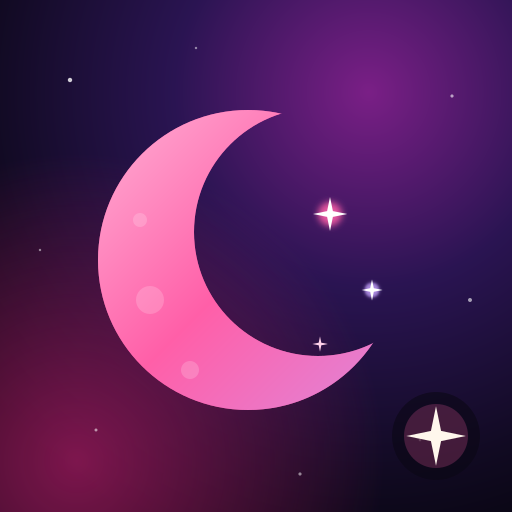

# Calendar

> **A Nova Agent panel.** Its code is in `web/calendar/` in Nova Agent's repo, and it opens inside Nova Agent at `/agent/calendar`.

**The studio's calendar under the real sky: note cards, day cards, the moon and special days, Nova Agent's plan and the studio's bookings, in one place.**

---

## What you can do

- **See it your way:** Month, Week, Day or List. Arrows (or a swipe) move on, **Today** comes back, and tapping the month's name jumps to any date. A pink line shows the time now.
- **Add a note card:** the **+** button, **+ Note card** under the day, a tap on an empty time (Week and Day), or a second click on a day (Month, on a computer). Typing is quickest: `Mix review Friday 2pm 1h @Studio A` fills everything in.
- **Every note card has its own painted picture** (a planet, a galaxy, a comet…): pick the kind or let it surprise you, press **New artwork** for another, and **Save image** to keep it big.
- **Change:** tap a note card to edit it. On a computer, drag it to move it and drag its bottom edge to make it longer; on a phone, hold it for a moment, then drag.
- **Repeat:** every day, week, month or year, or a custom rule (every 2 weeks on Mon and Wed, until a date or a number of times). Changing or deleting one of them asks: just this one, this and the ones after, or every one.
- **Reminders:** at the start, 10 or 30 minutes, an hour or a day before. They arrive on phones as alerts, even with every laptop off.
- **Delete** with **Undo** (a few seconds to change your mind), **duplicate**, pick a **colour**, add **where** and **notes**.
- **Day cards:** birthdays, release days, studio sessions, holidays and more (**+ Day card**). Each has a kind with its icon, a **title style** (Nebula, Supernova, Orbit, Constellation, Eclipse, Aurora, Celestial), its own **theme** and a painted header (**New artwork** for another). They show as a banner on the day, wear their theme in the month, and can come back every year.
- **The real sky:** the moon's phases (full moons in gold, with their names), and special days (Easter, Bonfire Night, the solstices and equinoxes, meteor-shower peaks…). Tap **Make it a day card** to keep one. The strip above the month shows its day cards, full moon and special days; tap one to go there.
- **Backup** (the layers button): **Export** downloads every note card and day card; **Import** brings a backup back in, including one from the old Calendar.
- **What to show** (the layers button): note cards, day cards, the moon and special days, Quests (Nova Agent's plan: read-only here, change them in Quests) and studio bookings (read-only, from the diary).
- **Search** every note card and day card by title, place or notes.
- **Icons that say what they are:** one modern line set throughout. A note card shows what it's about (a mic for a recording, a cake for a birthday, a plane for travel…), a studio booking shows a ticked calendar, a quest a target; each day-card kind has its own (a ghost for Halloween, a flame for Bonfire Night, a party popper for New Year, a suitcase for a trip). Point at one for its name.

## Works with Nova Agent

- Ask Agent (a note card is what Agent calls an event): "Add a mix review Friday at 2 for an hour at Studio A", "Move it to 4", "Make the standup repeat every weekday", "Remind me 10 minutes before", "Delete it".
- Nova Agent's planner keeps Quests out of your note cards (every time a repeating one happens). All-day note cards are markers, like day cards, not busy time.

## Where it's kept

The calendar lives on Nova Bot (its D1 database, `calendar_items`), so it's the same on every phone and computer and keeps working with every laptop off. Each browser keeps a copy so it opens instantly and works offline; changes made offline save when you're back. The latest change wins; if another device changed something later, Calendar shows that and says so.

Nova Agent (on the VPS) keeps its own copy (`data/calendar.json`, read by its chat and planner) in step with Nova Bot every few seconds (`src/calendar/cloud.ts` ⇄ `POST /nova-agent/calendar`).

Anything an earlier version of Calendar saved in a browser is brought in the first time it opens there (once, never twice).

## For developers

| File | What it is |
|---|---|
| `web/calendar/js/cal.js` | The views, the editor, drag, keys, backups |
| `web/calendar/js/presets.js` | Day card kinds, title styles and line icons |
| `web/calendar/js/sky.js` | Moon phases, full moon names, seasonal and cosmic days |
| `web/calendar/js/cosmos.js` | The painted pictures (loaded when first needed) |
| `web/calendar/js/themes.js` | The themes a day card can wear |
| `web/calendar/js/data.js` | Saving to Nova Bot, the offline copy and queue, bringing in old data |
| `web/calendar/js/recur.js` | Repeat rules (shared with Nova Agent's planner and Nova Bot's reminders) |
| `web/calendar/js/quickadd.js` | "Mix review Friday 2pm 1h" → a note card |
| Nova Bot `src/calendar/items.js` | `GET/PUT/DELETE /app/api/calendar/items`, Nova Agent's sync |
| Nova Bot `src/calendar/reminders.js` | Reminders on phones (every minute) |

Keys: ← → move, **T** today, **N** new, **M W D L** views, **Esc** closes.
