# Hub

The staff side of the studio, as a Nova Agent panel: enquiries, website chats, bookings, alerts, Ask NovaBot and push notifications to the staff phones. On the studio PC it opens inside Nova Agent (sign in on the Portal panel); away from it, it's online at Nova Bot's address, `/app/`, and installs on a phone as Nova Agent.

Its data and push come from Nova Bot (`/app/api/*`).

Hub lives at `/app/` (online) and inside Nova Agent on the studio PC. It's a phone-first web app that installs to the home screen,
and turns into a side-rail layout on a desktop. Staff sign in with
Portal (or, for now, the studio's shared
password).

<table>
  <tr>
    <td width="33%" valign="top">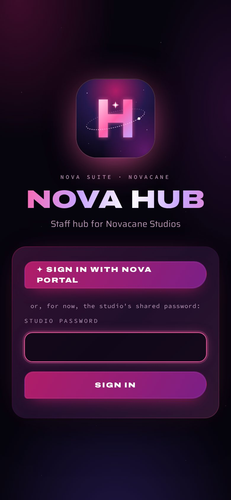 <b>Sign in</b> with Portal, or the studio's shared password.</td>
    <td width="33%" valign="top"> <b>Enquiries</b>: email, call, send a booking link, read the chat, mark done.</td>
    <td width="33%" valign="top"> <b>The smart calendar</b>: the week at a glance, and days that glow as they fill.</td>
  </tr>
  <tr>
    <td width="33%" valign="top">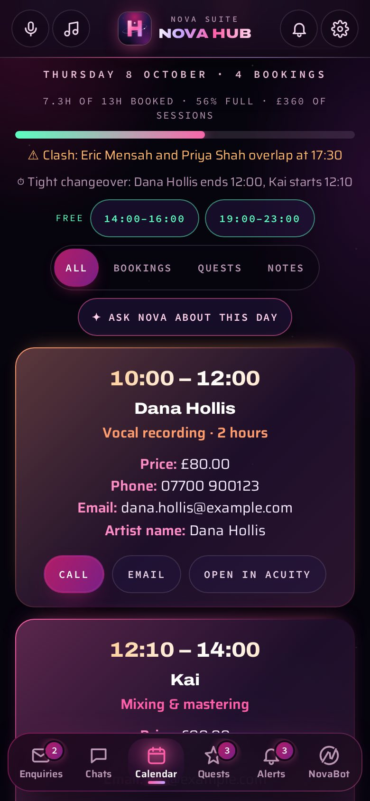 <b>A day</b>: how full it is, a clash, a tight changeover, and free slots.</td>
    <td width="33%" valign="top"> <b>Quests</b> from Nova Agent: what's on now and today's plan.</td>
    <td width="33%" valign="top"> <b>Missions</b>: progress, deadlines and anything at risk.</td>
  </tr>
  <tr>
    <td width="33%" valign="top"> <b>Alerts</b>: every booking is checked with Acuity itself.</td>
    <td width="33%" valign="top">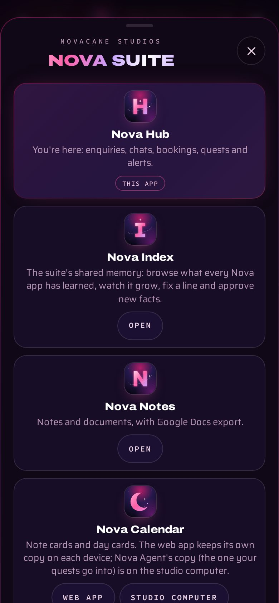 <b>The Nova Agent sheet</b>: every app, one tap away.</td>
    <td width="33%" valign="top">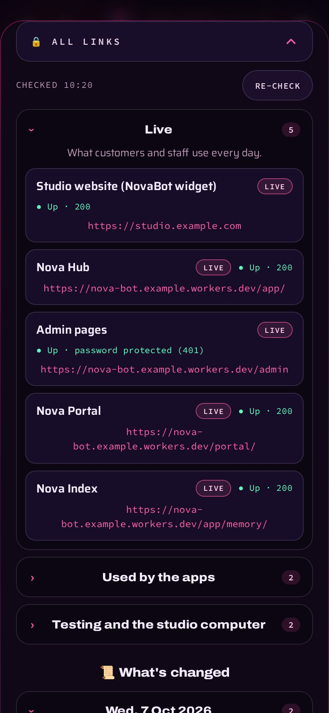 <b>🔒 All links</b>, each checked as you open it.</td>
  </tr>
  <tr>
    <td width="33%" valign="top">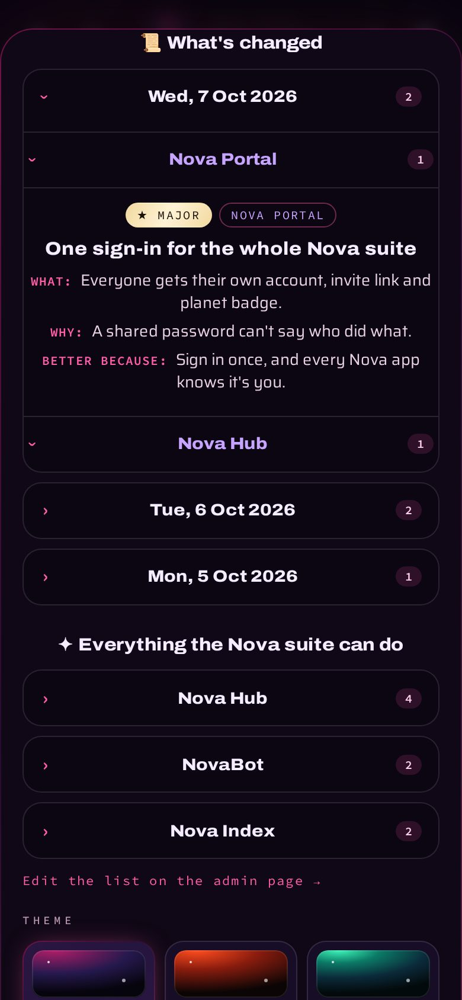 <b>What's changed</b> and <b>everything the suite can do</b>.</td>
    <td width="33%" valign="top"> <b>Options</b>: theme, text, motion, sound and the starting tab.</td>
    <td width="33%" valign="top">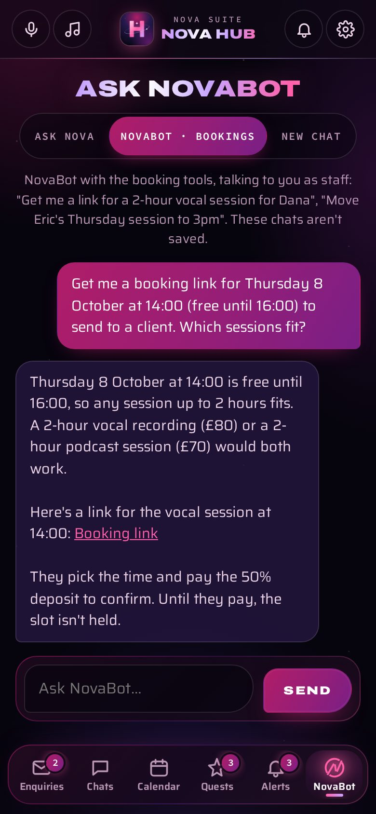 <b>Ask NovaBot</b> in staff mode: a booking link, deposit first.</td>
  </tr>
</table>

  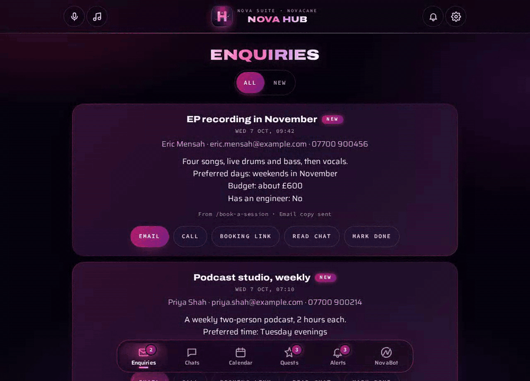 
  Tap a free slot, and NovaBot · bookings opens with the request already written.

## The tabs

| Tab | What it does |
|---|---|
| **Enquiries** | Every enquiry NovaBot took. Email, call, make a booking link with the customer's details filled in, read the chat it came from, mark it done. |
| **Chats** | What customers asked NovaBot on the website (kept for 90 days). |
| **Calendar** | Every booking in Acuity's diary, as a month you can swipe, with Calendar's cards and planned quests alongside. See [the smart calendar](#the-smart-calendar). |
| **Quests** | Nova Agent's plan, synced from the studio computer: the quest on now, repeating pulses, today, Missions with progress rings, and every quest. Taps (Start, Done, +15 min, Not now, Skip, Pause) go straight back to Nova Agent. |
| **Alerts** | Every notification that reached a phone, newest first, with colour-coded labels, exact times, Call/Email buttons and an auto-delete switch. |
| **NovaBot** | Two chats. **Ask Nova** answers questions about the studio's bookings, enquiries and alerts (Nova Bot's `src/studio-ask.js`). **NovaBot · bookings** is NovaBot with the booking tools, talking to you as staff: get a link for a client, find, move, cancel or change a booking. Every change shows a summary and waits for a yes. |

## The smart calendar

- **The week at a glance**: sessions, hours booked and how full, session value, the
  busiest day, the next free hour, and any clashes.
- **Glowing days**: each day glows brighter as it fills; a nearly full day says FULL.
- **A day in detail**: hours booked, a fill meter, ⚠ clashes, ⏱ tight changeovers (under
  15 minutes), and free slots of an hour or more within opening hours.
- **One tap from a booking link**: tapping a free slot opens NovaBot · bookings with the
  request written for you. "✦ Ask Nova" buttons ask about the week or the day.

## Features

- **Real-booking checks.** A booking alert asks Acuity about that booking as it comes into
  view: "✓ Real booking: confirmed in Acuity", with the deposit paid, or "Cancelled" or
  "Not found". Tests are labelled as tests, so nothing fake can pass for a booking.
- **Push notifications that work with the app closed** (`src/push.js`, `public/app/sw.js`).
  New enquiries, bookings (with every detail from Acuity's private calendar feed), and
  alerts from Nova Agent, Quest and Mission. Android gets rich notifications
  with their own buzz; iPhones get the plain version, so nothing is ever lost.
- **Pings.** With Hub open, an alert rings out with a bright ping (a different one for
  each kind) and drops a banner from the top.
- **Staff voice.** Tap the mic and say what to do ("show alerts", "call Eric", "new
  enquiries", "ask NovaBot what the prices are"); Whisper on Workers AI writes it down.
  Hands-free mode listens while the app is open for anything that starts with "Nova".
- **Quests from Nova Agent** (`src/agent-nova.js`): Nova Agent sends its plan here every
  time it changes, and picks up taps within about a second.
- **Ambient music** (`public/app/ambient.js`): a gentle, never-ending soundtrack made live
  on the phone with the Web Audio API. No audio files.
- **Sound effects** (`public/app/sfx.js`): soft bells and sparkles for taps, tabs,
  switches, sends and deletes, all in one key, and a two-note chime when NovaBot answers.
- **Six themes**: Cosmic, Ember, Aurora, Ocean, Gold and Mono, shared with the admin pages.
- **Options** (`public/app/options.js`): theme, text alignment and size, how times show on
  alerts, animations, the drifting starfield, sound effects, pings, music volume and the
  starting tab. Saved on the device.
- **The suite sheet** (`public/app/suite.js`): tap the Hub brand to see every Nova app,
  🔒 **All links** (every live and testing address, each checked on the spot), **What's
  changed** (every change by day and app: what, why and what's better), **everything the
  suite can do**, and the theme picker.

<table>
  <tr>
    <td width="50%">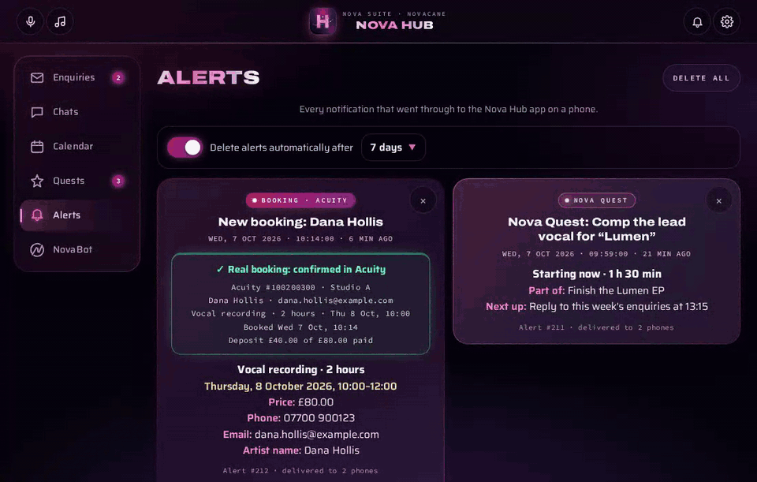 Switching themes in Options.</td>
    <td width="50%">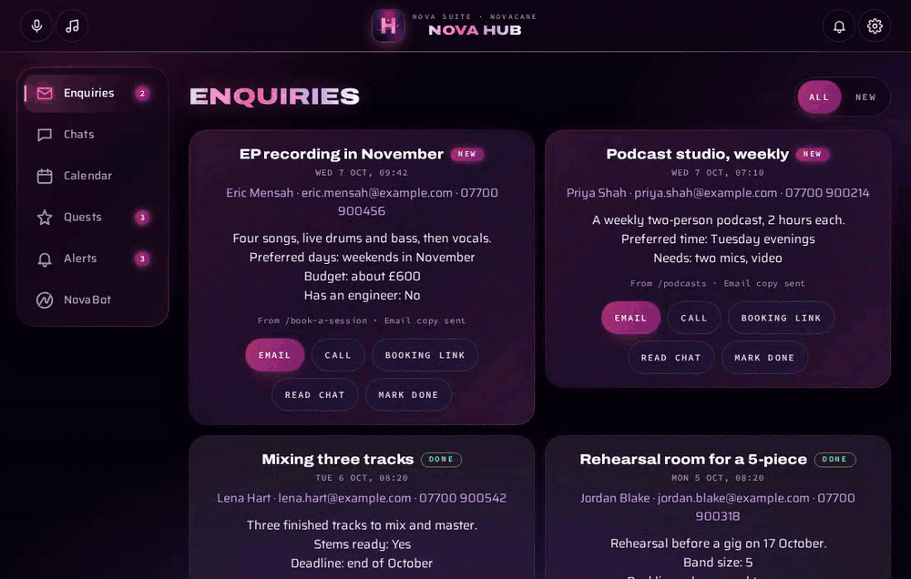 Browsing the suite sheet.</td>
  </tr>
</table>

  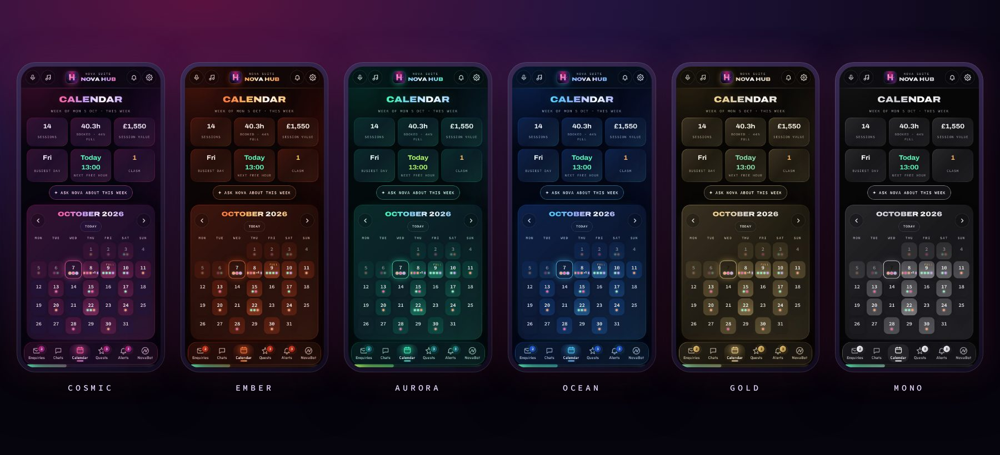 
  One screen, six themes.

  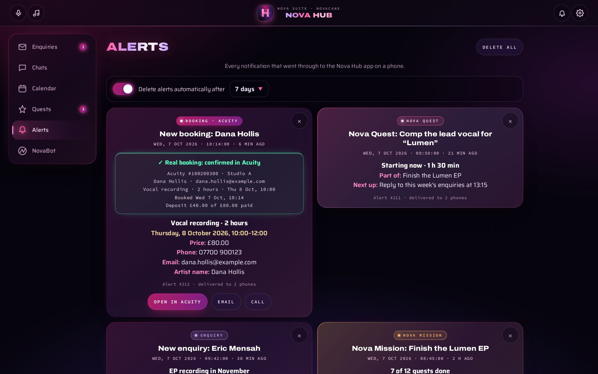 
  On a desktop, the tabs become a side rail and lists go two-up.

<b>Ask Nova</b> (questions about the studio's own diary)

 

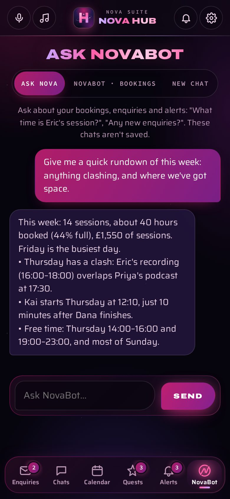

**Behind the scenes:** Acuity's API can't change a booking's session type, price or paid
status, so those changes are queued for [Nova Agent](https://github.com/tuniveza/nova-agent),
the browser helper on the studio computer, which does them in Acuity's admin pages and
reports back (`src/agent-nova.js`). Every day at 06:00 UK time the Worker checks it can
still reach Acuity's API and alerts staff phones if not (`src/health.js`).
