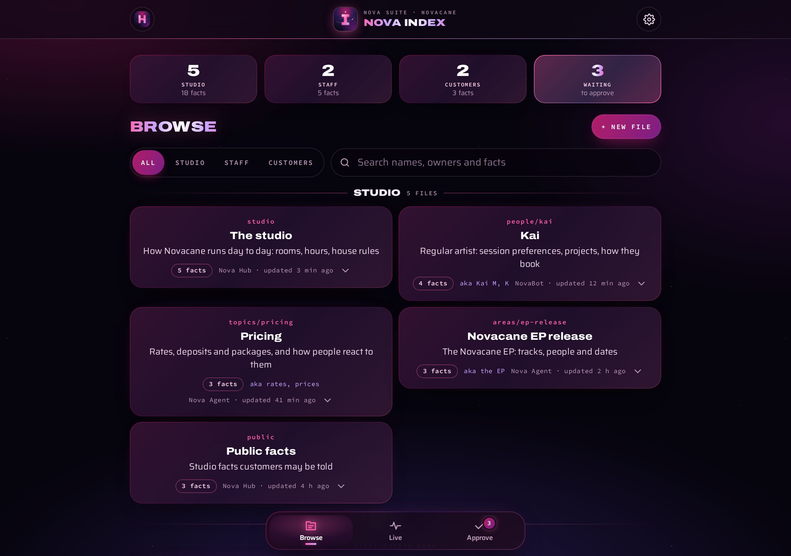
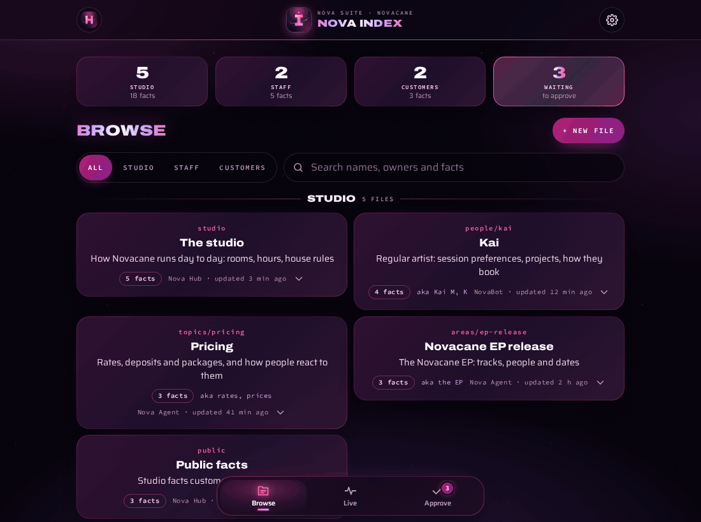
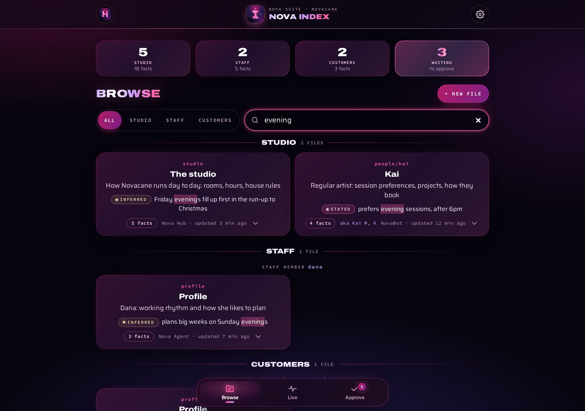
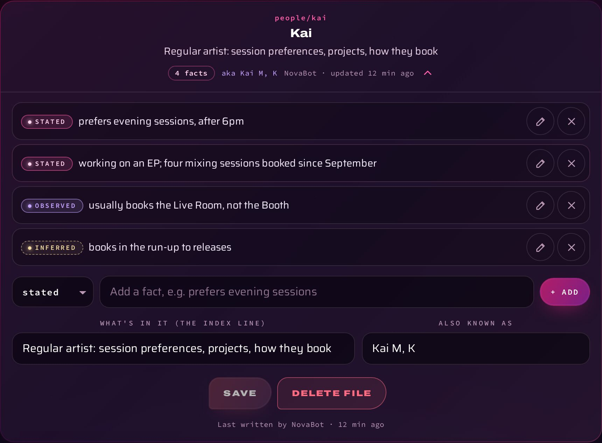
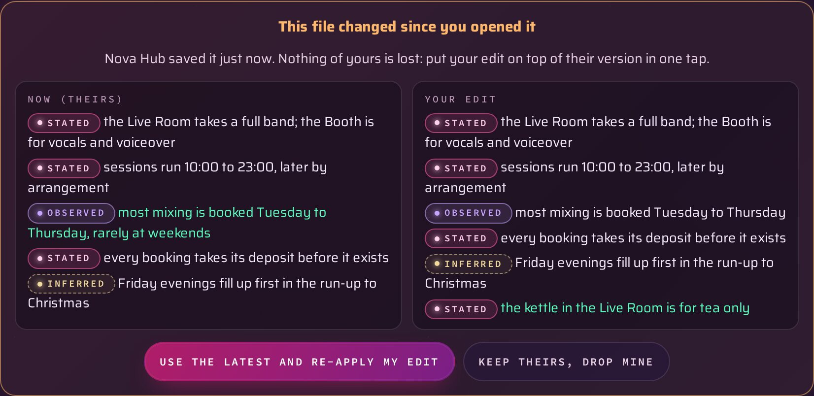
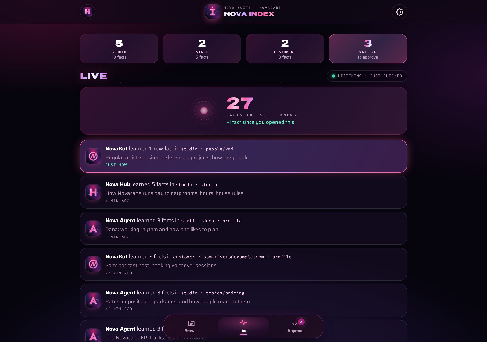
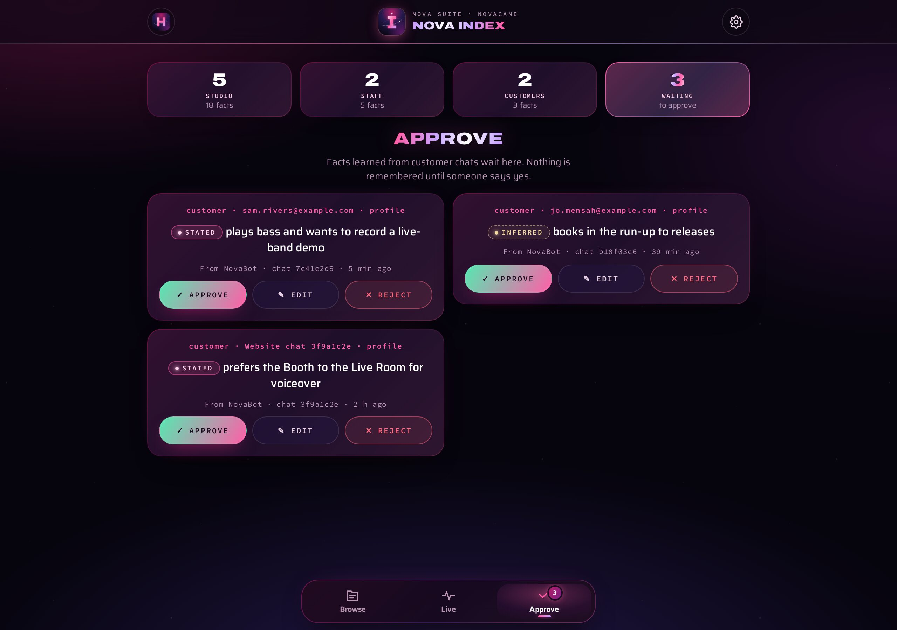

<div align="center">



# Index

> **A Nova Agent panel.** Its code is in `web/index/` in Nova Agent's repo, and it opens inside Nova Agent at `/app/memory/`. Online, Nova Bot serves it at the same address.


**Everything Nova Agent remembers, in one place.**<br>
Browse it, watch it grow, fix a line, and say yes or no to what's been learned about customers.


</div>

---

Every Nova app hands its conversations to one shared memory. A tiny set of tagged, one-line
facts comes out, kept in small files by subject. Before replying, each app reads back only the
few files that matter for that turn. Index is the window onto that memory.

> The test for every fact: **"Would this still be true and useful in three months?"** If not, it isn't kept.

All the pictures here use made-up files and people.

<p align="center">
  <br>
  <sub>Open a file, add a fact, save; then approve a fact learned from a customer chat.</sub>
</p>

## What it does

### Browse

Studio, staff and customer files as cards, grouped by who they're about, with counts at the
top (tap one to jump to it). The **scope chips** (All, Studio, Staff, Customers) narrow it
down, and **search** looks through names, aliases, owners and descriptions, and inside the
facts themselves: a card shows the line that matched, with your words lit up.
**+ New file** starts one by hand.

<table>
  <tr>
    <td width="50%"></td>
    <td width="50%"></td>
  </tr>
  <tr>
    <td><sub><b>Search</b> finds facts, not just file names.</sub></td>
    <td><sub><b>An open file</b>: each fact with its tag pill, ready to edit.</sub></td>
  </tr>
</table>

### Edit, safely

Open a file to change, add or delete a fact (and its tag), its description (the line the apps
use to decide whether to read it) or its aliases. **Save** only goes through if nobody else has
saved the file since you opened it. If someone has, you see both versions side by side, with
the differences lit up, and can put your edit on top of theirs in one tap, or keep theirs.

<p align="center"></p>

### Live and Approve

<table>
  <tr>
    <td width="50%"></td>
    <td width="50%"></td>
  </tr>
  <tr>
    <td><sub><b>Live</b>: what the suite just learned, and which app learned it.</sub></td>
    <td><sub><b>Approve</b>: nothing about a customer is kept until someone says yes.</sub></td>
  </tr>
</table>

- **Live** shows what the suite has just learned, and which app learned it (NovaBot, Nova
  Agent, Portal, Index). It checks every 20 seconds while it's on screen, and anything
  new glows as it arrives. Tap a row to open the file.
- **Approve** holds facts learned from customers. One tap approves, edits or rejects each one.
  Nothing about a customer is kept without a person saying yes.
- **Options**: the theme (shared with Portal), sound effects, refresh everything, open
  Portal and sign out. It installs as an app, with the suite's cosmic "I".

### Smart extras

- **Search that forgives.** Typos are fine ("evnings", "pricnig"), and so are other forms of a word ("evenings" finds "evening"). When nothing matches, Index offers **Did you mean …?** with the closest words it knows.
- **Filters**, under the search: what kind of file (the studio, public facts, profiles, people, topics, areas), when it last changed (today, this week, this month, or 6+ months old), and **★ Pinned**. It shows how many files are left, with **Clear filters**.
- **Ask Index.** Type a question ("when does Kai like to record?") and press Enter, or tap **✦ Ask Index**. The answer comes only from what's remembered, with numbered sources: tap one to open its file. A small, cheap AI writes the answer, and asking the same thing again is free until memory changes. Without a match it says so and asks no AI. It only reads: nothing is sent or saved. Each person only gets answers from what they're allowed to see (Nova Agent's key never reads customers').
- **Pinned and recent.** **☆ Pin** a file (at the foot of an open file) to keep it at the top of Browse; the files you open most lately are listed under it. Kept in this browser only.
- **Related.** An open file lists the other files about the same people and things.
- **Hints.** Files that might be the same person or subject ("Kai" and "Kai M"), and files that haven't changed in 6 months (**Show them**). **✕** puts a hint away.
- **Keys.** **Ctrl+K** (or **/**) jumps to the search from anywhere; **↓** goes to the first file, **↑ ↓ Home End** move between files, **Enter** opens one and **Esc** closes it (or clears the search).
- **Approve:** a fact learned in a website chat has **Open the chat**, to see what was said in Portal.

The logic is in `web/index/smart.js` (tested on its own: `test/index-smart.spec.ts`); Ask Index's answers come from Nova Bot (`src/memory/ask.js`, `POST /app/api/memory/ask`).

## How the memory works

```
- [stated]   said directly          "prefers evening sessions"
- [observed] seen in what happened  "usually books the Live Room"
- [inferred] a clear pattern        "books in the run-up to releases"
```

| | |
|---|---|
| **Scopes** | `studio` (shared, including `public`, which customers may be told), `staff` (one set per staff member), `customer` (one set per client: their email, or a website chat until it's known) |
| **Paths** | `studio`, `public`, `profile`, `people/<name>`, `topics/<subject>`, `areas/<name>` |
| **Learning** | In the background, so no reply ever waits. A small model pulls out only durable facts; each file is then rewritten with them folded in, never just added to. Files past about 3 KB are condensed. Card, bank and ID numbers are never kept. |
| **Reading** | Each turn loads the studio file and the person's profile, plus at most three other files whose description or aliases match, within a budget of about 800 tokens |
| **Saving** | Every write carries the version it was based on; a clash returns the current file instead of overwriting it |

**Who sees what** is decided by the server, never by the app asking:

| Who | What they can see |
|---|---|
| Nova Agent (its key) | The studio's memory and staff memory; never customers' |
| The website's NovaBot | Only that customer's own file and the public studio facts |
| Portal and Index, signed in | Everything, including approvals |
| Staff signed in with [Portal](https://github.com/tuniveza/nova-portal) | Staff who aren't admins: the studio's memory and their own; admins: everything |

Index signs in with **Portal**, the suite's one sign-in ("✦ Sign in with Nova
Portal"), so each person sees what's theirs to see.

The memory engine runs on Nova Bot's worker (`src/memory/` in
[nova-bot](https://github.com/tuniveza/nova-bot)): the store, extraction and the API. The
memories live in its database, never in git. The full design is in [docs/spec.md](spec.md).

