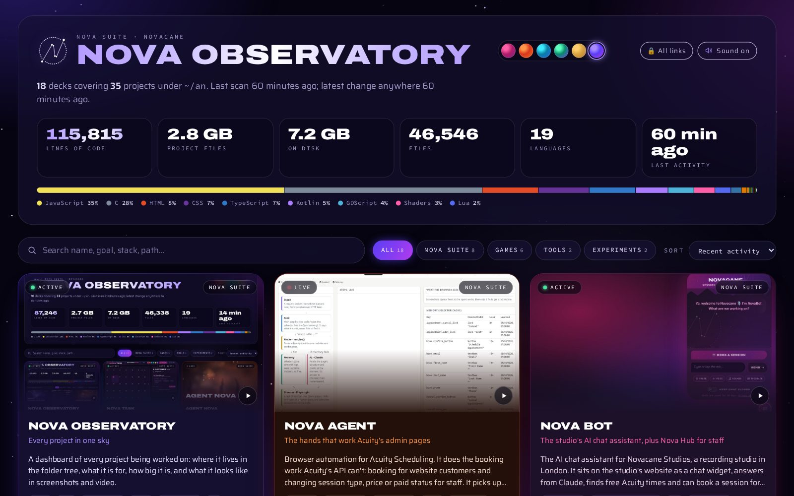
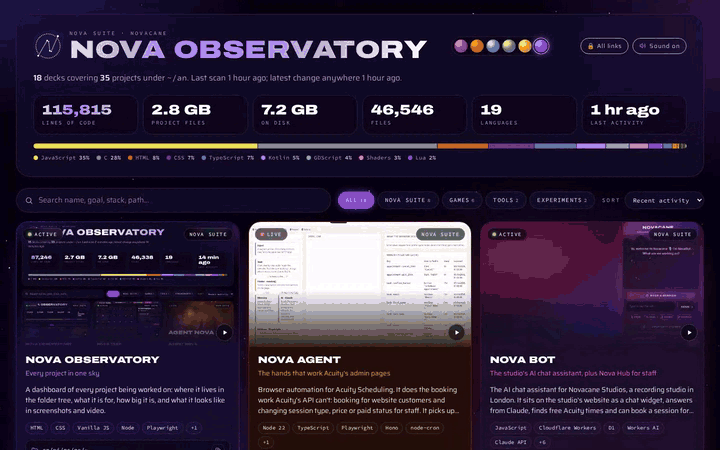
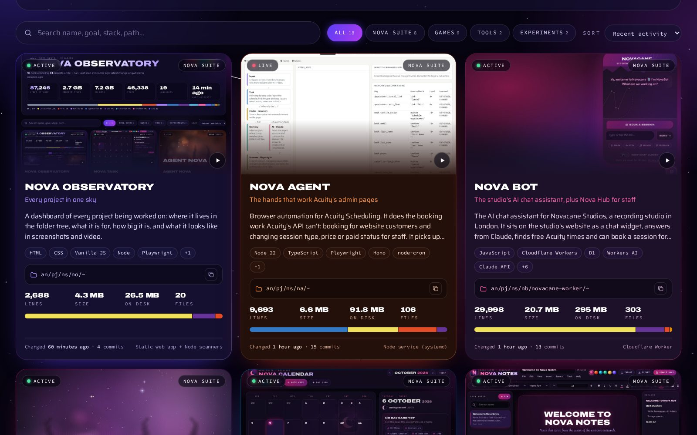
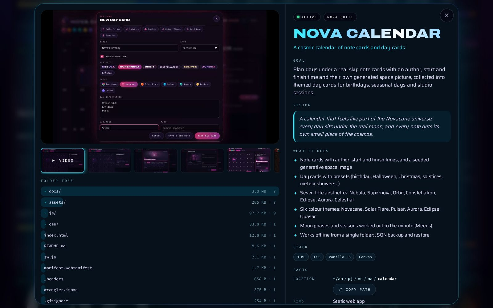
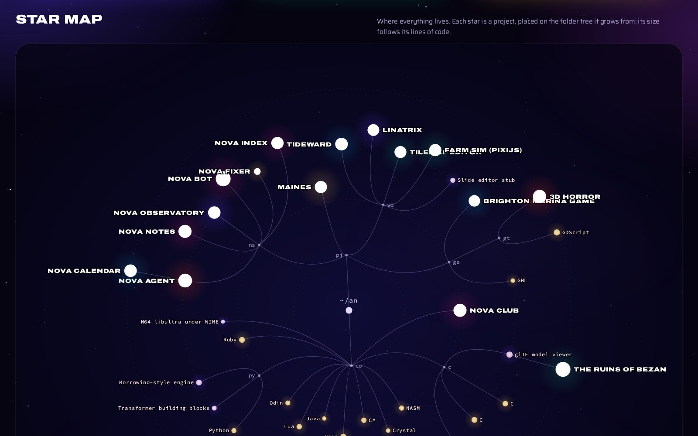
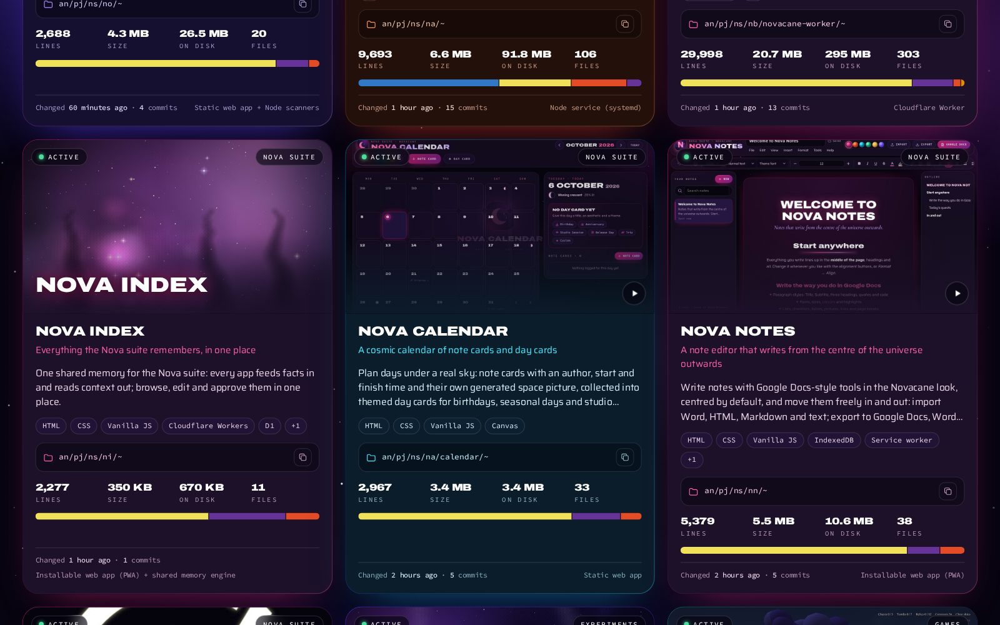
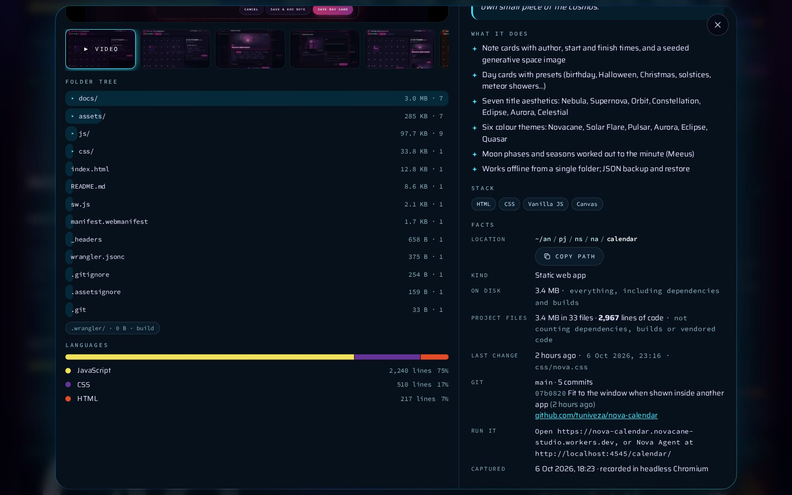
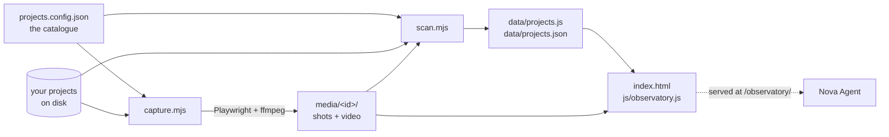

# Observatory

> **A Nova Agent panel.** Its code is in `web/observatory/` in Nova Agent's repo, and it opens inside Nova Agent at `/observatory/`.

**Every project in one sky: a dashboard that measures your work on disk and shows it in screenshots and video.**

Always on inside Nova Agent at <code>/observatory/</code> · or open <code>index.html</code> anywhere

---

Observatory is a dashboard of everything being worked on. It's kept true by scanning the
disk rather than by hand: one script measures every project, another opens each one in headless
Chromium and records screenshots and a short demo video, and a static page shows the lot as
project decks and a star map.

The screenshots here come from the studio's own catalogue: Nova Agent, plus games, tools
and experiments. They show project names, sizes and folder trees, and nothing personal.

## What's new

| | |
|---|---|
| 🔔 **Sound switch** | Soft cosmic sound effects on every press. The **Sound on / Sound off** switch beside All links turns them off and on. |
| 🔒 **All links** | A pill in the header that opens the password-protected page with every Nova Agent address, live and testing. |
| ✦ **Served by Nova Agent** | Nova Agent serves it at `/observatory/`, so it's always on while Nova Agent is. |
| 🧠 **Index** | The suite's shared memory now has its own deck. Portal may join it later. |

## See it in action

Scroll the decks, then open one for the full story.

## What it does

Each project gets a **deck** showing:

- where it lives in the folder tree
- its goal and vision, and what it does
- its size on disk, project files, lines of code and languages
- git state and last activity
- screenshots and a demo video (or a generated cosmic cover)

And across all of them:

| | |
|---|---|
| **Totals** | Lines of code, project files, size on disk, files, languages and last activity, with a language bar |
| **Search, filter and sort** | By name, goal, stack or path; by category; by recent activity and more |
| **A detailed view** | Each project's video, screenshots, folder tree, languages and facts |
| **A star map** | The whole folder structure, with every project as a star sized by its lines of code |
| **Six colour themes** | Shared with [Calendar](https://github.com/tuniveza/nova-calendar) and [Notes](https://github.com/tuniveza/nova-notes) |
| **Sound effects** | The shared Nova Agent sounds, with a switch in the header |

## Screenshots

<table>
  <tr>
    <td width="50%"> <b>Project decks.</b></td>
    <td width="50%"> <b>A project up close.</b></td>
  </tr>
  <tr>
    <td width="50%"> <b>The star map.</b> Each star sits on its folder; bigger stars have more code.</td>
    <td width="50%"> <b>Index</b>, the newest deck in Nova Agent row.</td>
  </tr>
  <tr>
    <td colspan="2" align="center"> <b>Folder tree, languages and facts.</b></td>
  </tr>
</table>

## Inside Nova Agent

[Nova Agent](https://github.com/tuniveza/nova-agent) serves this folder at **`/observatory/`**
(<https://nova.novacane.co.uk/observatory/>) whenever it's running, so the Observatory is
always on there with the latest scan. Nova Agent looks for it next to itself, in `../no`.

## Sound effects

Every press makes a soft cosmic sound, made live with the Web Audio API (no sound files) and kept
quiet. The **Sound on / Sound off** switch beside **🔒 All links** turns them off and on, plays a
little chime when it does, and is remembered on each device. The same `js/sfx.js` makes the
sounds in Notes and Calendar.

## How it works

| File | Job |
|---|---|
| `projects.config.json` | Your catalogue. It holds what a scan can't know: each project's name, goal, vision, features, category, theme, and how to show it. **Add a project here.** Git ignores it; start from `projects.config.example.json`. |
| `scan.mjs` | Measures each project on disk. Writes `data/projects.json` and `data/projects.js`. |
| `capture.mjs` | Drives headless Chromium (Playwright) and ffmpeg. Writes into `media/<id>/`. |
| `index.html`, `css/`, `js/observatory.js` | The page. |
| `js/themes.js`, `js/cosmos.js`, `js/backdrop.js` | Shared with Calendar: the colour themes, the generative space covers and the star backdrop. |
| `js/sfx.js` | The Nova Agent sound effects, shared with Notes and Calendar. |

**What counts as what in a scan:**

- **On disk** is everything, from `du`.
- **Project files** and **lines of code** leave out:
  - dependencies and build output: `node_modules`, `build*`, `dist`, `.gradle`, `.godot` and so on
  - vendored third-party code: `lib`, `deps`, `glad`, `Libs`, `vendor`, `thirdparty`
  - anything listed under `exclude` in the catalogue, such as copied-in SDL or cglm headers
- Lines are counted only for code. Markdown, JSON, XML and config files don't count.

### Capture

**Capture modes** (`capture.mode` in the catalogue):

| Mode | What it does |
|---|---|
| `page` | Opens the project in Chromium and plays a short scripted demo, recording the screen. The project can be opened as a file, from a local static server (`serve`, with optional `mounts`), from the project's own Vite (`vite: true`) or from a `url`. The demo scripts are in `capture.mjs` under `SCRIPTS`. |
| `images` | Turns pictures already in the project into a Ken Burns slideshow video. |
| `none` | Shows a generated cosmic cover instead. |

**Safety:** during capture, every request that leaves the machine is blocked, except Google
Fonts, and every non-GET request is blocked too. A demo can type into a chat widget, but nothing
can reach a live service.

**Private projects:** projects marked `"private": true` are skipped unless you pass
`--include-private`. Use it for anything whose pages can show personal data (Nova Agent's
visualizer can show client names, so it's marked private in the example).

