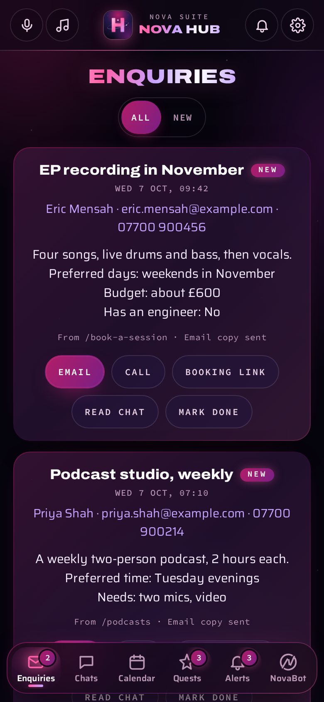
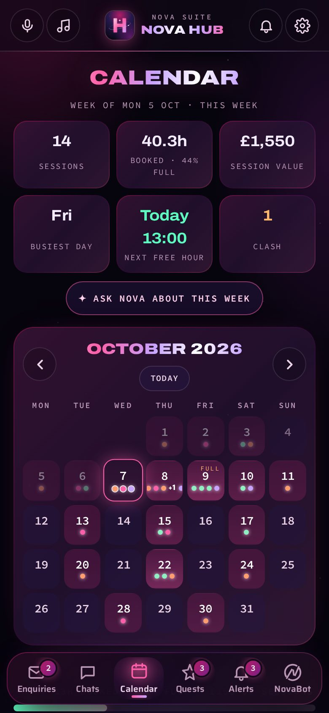
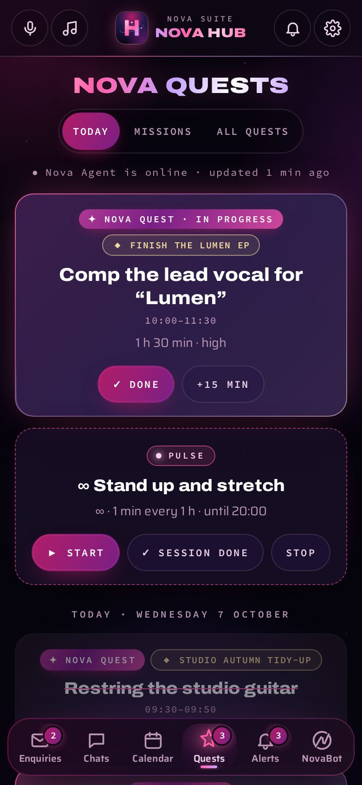
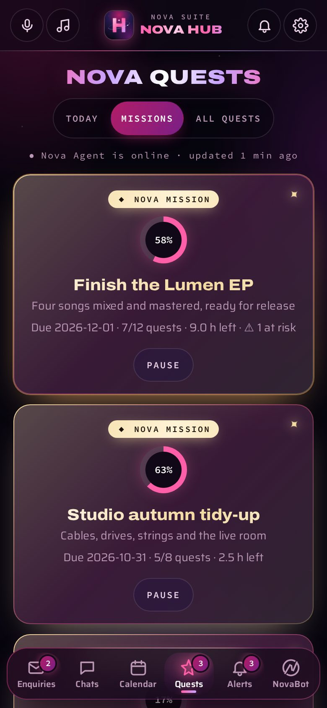
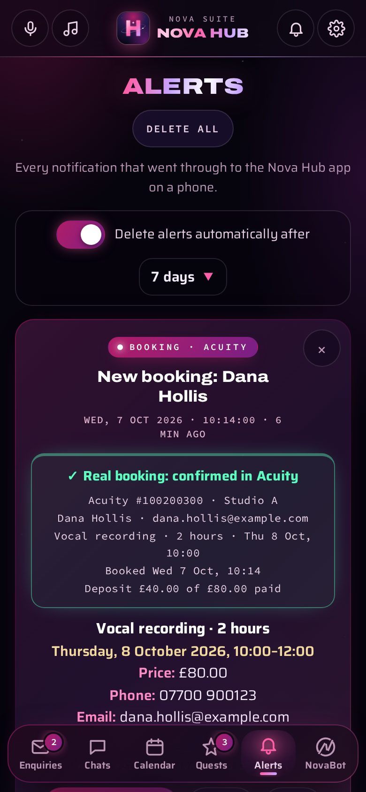
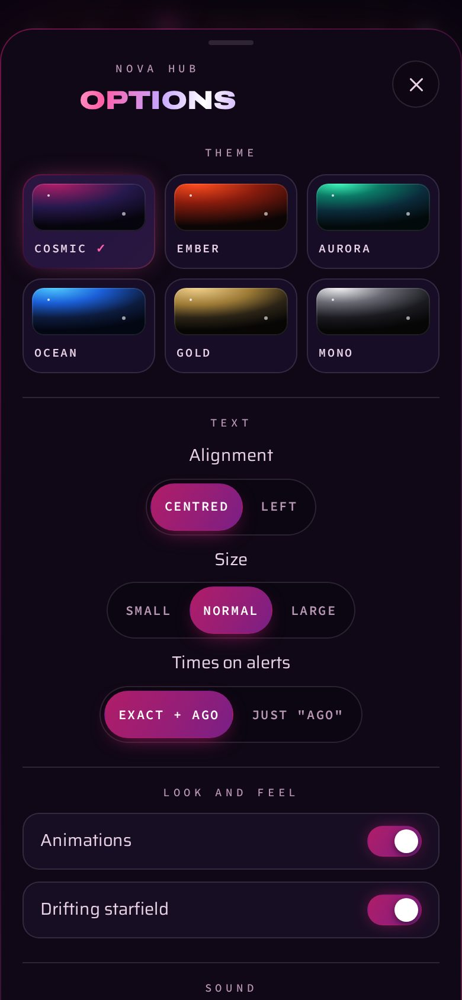
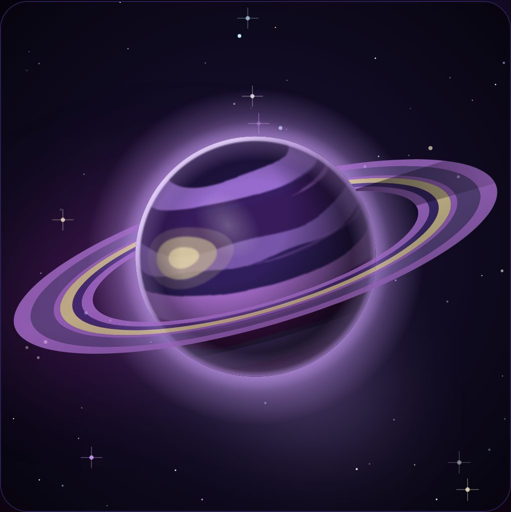

# Portal

> **A Nova Agent panel.** Its code is in `web/portal/` in Nova Agent's repo, and it opens inside Nova Agent at `/portal/`. Online, Nova Bot serves it at the same address, and it installs on a phone.

**The studio's staff app, one sign-in for the whole of Nova Agent, and a planet for everyone.** A panel of [Nova Agent](https://github.com/tuniveza/nova-agent), for Novacane Studios.

Portal is where the staff work: enquiries, website chats, bookings, quests, alerts, Ask NovaBot and push notifications to the staff phones. It's also where you sign in (once, for Portal, Index and the admin pages), and where every member of the team has a profile with a unique planet, drawn from their id.

Portal's old address, `/app/`, opens Portal (with the same tab: `/app/?view=alerts` is `/portal/?view=alerts`). Phones that added Portal to the Home Screen keep working and keep getting notifications; adding Portal to the Home Screen gives the new icon.

## The tabs

Along the bottom on a phone, down the side on a desktop:

| Tab | |
|---|---|
| **Enquiries · Chats · Calendar · Quests · Alerts · NovaBot** | The work tabs. See [the work tabs](#the-work-tabs). |
| **You** | Your planet (it's the tab's icon), your profile, your Index, and for admins the crew and the admin pages. |

The address follows the tab, so a reload or a link lands in the same place: `/portal/?view=enquiries` (or `chats`, `calendar`, `quests`, `alerts`, `bot`), `/portal/?view=me`, `/portal/?view=crew`, `/portal/?id=<someone>`. With no `?view=`, Portal opens on the starting tab from Options; a Nova Agent notification (`#nova`) opens Alerts.

<table>
  <tr>
    <td width="33%" valign="top"> <b>Sign in</b> with Portal.</td>
    <td width="33%" valign="top"> <b>Enquiries</b>: email, call, send a booking link, read the chat, mark done.</td>
    <td width="33%" valign="top"> <b>The smart calendar</b>: the week at a glance, and days that glow as they fill.</td>
  </tr>
  <tr>
    <td width="33%" valign="top"> <b>A day</b>: how full it is, a clash, a tight changeover, and free slots.</td>
    <td width="33%" valign="top"> <b>Quests</b> from Nova Agent: what's on now and today's plan.</td>
    <td width="33%" valign="top"> <b>Missions</b>: progress, deadlines and anything at risk.</td>
  </tr>
  <tr>
    <td width="33%" valign="top"> <b>Alerts</b>: every booking is checked with Acuity itself.</td>
    <td width="33%" valign="top"> <b>The Nova Agent sheet</b>: every app, one tap away.</td>
    <td width="33%" valign="top"> <b>🔒 All links</b>, each checked as you open it.</td>
  </tr>
  <tr>
    <td width="33%" valign="top"> <b>What's changed</b> and <b>everything the suite can do</b>.</td>
    <td width="33%" valign="top"> <b>Options</b>: theme, text, motion, sound and the starting tab.</td>
    <td width="33%" valign="top"> <b>Ask NovaBot</b> in staff mode: a booking link, deposit first.</td>
  </tr>
</table>

   
  Tap a free slot, and NovaBot · bookings opens with the request already written.

## Signing in

- **Sign in once, everywhere:** email and password give you a secure session that Portal, Index and the admin pages all trust. Signing out (from any of them) ends it everywhere at once.
- **Setting up:** the very first admin is created with the `ADMIN_PASSWORD` secret, to prove it's you. After that, admins **invite** people with a link (valid for 7 days), and each person chooses their own password. Nobody else ever knows it.
- **On the studio PC**, signing in here signs Nova Agent in to Nova Bot as you.
- **Nova Club and other native apps** can sign in through the same API and get an app token instead of a cookie.

## You, and the crew

- **Your profile:** your planet, big and animated, with your name, role and "member since". You can re-roll your planet (or go back to your original), change your name, open your own Index, and sign out.
- **The crew (admins):** everyone as a planet, with their role, status and last sign-in. Invite people, change roles, switch accounts off (which signs them out at once), and send fresh invite links.
- **Roles:**
  - **Admins** see and manage everything, including customers' facts and approvals in Index.
  - **Staff** see the studio's memory and their own partition.
- **The badge, on every Nova Agent panel:** `<nova-portal-badge>` shows your planet, your name and your role in the top bar. Tap it for your planet up close and links to your profile and your Index.
- **The Manual, on every panel:** `<nova-manual>` sits beside the badge. It has a **Guide**, **How it's built**, the **History** and **What's new** for every panel, with search. Press **?** on any panel, or add `#nova-manual` to the address.

<table><tr>
<td width="50%"></td>
<td width="50%"></td>
</tr></table>

## The work tabs

| Tab | What it does |
|---|---|
| **Enquiries** | Every enquiry NovaBot took, sorted like a ticket inbox: New, Open, Waiting on them, Done and Spam (one press moves it; likely spam lands in Spam by itself, with the reason, and nothing is ever deleted). Who's on it, a label, search, and the team's saved replies for routine questions. Email, call, make a booking link with the customer's details filled in, read the chat it came from. Details: Nova Bot's README-ENQUIRIES.md. |
| **Chats** | What customers asked NovaBot on the website (kept for 90 days). Mark a chat **Needs a person** (you're put on it) or **Done**, and filter by either, so follow-ups don't get lost. |
| **Calendar** | Every booking in Acuity's diary, as a month you can swipe, with Calendar's cards and planned quests alongside. See [the smart calendar](#the-smart-calendar). |
| **Quests** | Nova Agent's plan, synced from the studio computer: the quest on now, repeating pulses, today, Missions with progress rings, and every quest. Taps (Start, Done, +15 min, Not now, Skip, Pause) go straight back to Nova Agent. |
| **Campaigns** | Email newsletters to fans and clients who opted in, sent through Resend once an admin approves them. Below them, **one-to-one emails**: a personal email to one person (a venue, label, brand or other business at its work address; a studio client; someone who wrote in). Agent or anyone in the team writes one; Nova Bot checks the person may be emailed (never anyone who said no; a client only about their own booking unless they said yes to studio news; no personal Gmail-style addresses as "business") and adds a footer with a "don't email me again" link (`/no-thanks`). Nothing is sent until an admin presses Approve (twice), and it goes exactly as approved, once. Someone who replies "no thanks" can be recorded under the list. Nova Bot's `src/outreach.js`, migration `0028_outreach.sql`. |
| **Alerts** | Every notification that reached a phone, newest first, with colour-coded labels, exact times, Call/Email buttons and an auto-delete switch. |
| **Social** | Facebook and Instagram posts. Write one (or let Agent draft it), add pictures and videos, pick a time; an admin approves it and Nova Bot posts it. See [Social](#social). |
| **NovaBot** | Two chats. **Ask Nova** answers questions about the studio's bookings, enquiries and alerts (Nova Bot's `src/studio-ask.js`). **NovaBot · bookings** is NovaBot with the booking tools, talking to you as staff: get a link for a client, find, move, cancel or change a booking. Every change shows a summary and waits for a yes. |

## Social

Facebook and Instagram posts, in Portal → Social (the Studio group, after Campaigns).

- **Writing.** Anyone signed in writes a post: the words (with Instagram's 2,200-character and
  30-hashtag counts), Facebook, Instagram or both, up to 10 pictures or videos, and a time (UK).
  Agent can draft and edit posts too (`create_social_draft`, `edit_social_draft`), but it can't add
  pictures, approve or post.
- **Approval.** Nothing is posted until an admin, signed in to Portal in a browser, presses Approve
  (twice: it says exactly what will happen). Nova Bot keeps a hash of exactly what was approved; any
  edit clears the approval.
- **Posting.** With Meta connected, Nova Bot posts it through Meta's Graph API, now or at its time
  (Instagram videos are checked every minute until Meta has them ready). Without Meta, the approved
  post waits under **Post these by hand**: copy the words, download the files, post it, then press
  **I posted it** (with the link, if you like). One platform can be connected and the other not.
- **Pictures and videos** are kept on the studio computer (Nova Agent's `data/social-media/`), so it
  has to be on when a post goes out. Pictures become JPEGs (what Instagram takes) before they're
  added; videos are MP4 or MOV, up to 25 MB from a phone (bigger from the studio computer).
- **Results, followers and comments** come from Meta every hour for 30 days. Replies to comments are
  drafts until an admin approves them. Dealt-with comments are deleted after 90 days.
- **Ideas and trends** opens Agent with a question ready to send. **Paid ads** stay in Meta's Ads
  Manager: Nova never spends money.

Connecting Meta (Nova Bot's secrets, with `npx wrangler secret put`):

1. In [Meta for Developers](https://developers.facebook.com/), make a Business app and add
   **Facebook Login for Business** and the **Instagram Graph API**. The studio's Instagram must be a
   Business or Creator account, linked to its Facebook Page.
2. In the Graph API Explorer, get a **user token** for the app with `pages_show_list`,
   `pages_read_engagement`, `pages_manage_posts`, `pages_manage_engagement`, `read_insights`,
   `instagram_basic`, `instagram_content_publish`, `instagram_manage_comments` and
   `instagram_manage_insights`. Exchange it for a **long-lived** one (Access Token Debugger → Extend),
   then call `GET /me/accounts` with it: the Page's `access_token` there doesn't expire.
3. Set `META_PAGE_TOKEN` (that Page token), `META_PAGE_ID` (the Page's id) and `META_IG_USER_ID`
   (`GET /<page id>?fields=instagram_business_account`). Portal → You → How it works → What Nova runs on shows what's
   connected.

When the VPS takes over the files: give Nova Agent another store in `src/social-media.ts` (the same
four functions) and set `SOCIAL_MEDIA_BASE` (where the VPS serves `<id>.<ext>`) and
`SOCIAL_MEDIA_KEY` on Nova Bot: it fetches files from there instead of the studio computer.

## The smart calendar

- **The week at a glance**: sessions, hours booked and how full, session value, the
  busiest day, the next free hour, and any clashes.
- **Glowing days**: each day glows brighter as it fills; a nearly full day says FULL.
- **A day in detail**: hours booked, a fill meter, ⚠ clashes, ⏱ tight changeovers (under
  15 minutes), and free slots of an hour or more within opening hours.
- **One tap from a booking link**: tapping a free slot opens NovaBot · bookings with the
  request written for you. "✦ Ask Nova" buttons ask about the week or the day.

## Features

- **Real-booking checks.** A booking alert asks Acuity about that booking as it comes into
  view: "✓ Real booking: confirmed in Acuity", with the deposit paid, or "Cancelled" or
  "Not found". Tests are labelled as tests, so nothing fake can pass for a booking.
- **Push notifications that work with the app closed** (Nova Bot's `src/push.js`, and `web/portal/sw.js`; phones that installed Portal from `/app/` keep `/app/sw.js`).
  New enquiries, bookings (with every detail from Acuity's private calendar feed), and
  alerts from Nova Agent, Quest and Mission. Android gets rich notifications
  with their own buzz; iPhones get the plain version, so nothing is ever lost.
- **Pings.** With Portal open, an alert rings out with a bright ping (a different one for
  each kind) and drops a banner from the top.
- **Staff voice.** Tap the mic and say what to do ("show alerts", "call Eric", "new
  enquiries", "ask NovaBot what the prices are"); Whisper on Workers AI writes it down.
  Hands-free mode listens while the app is open for anything that starts with "Nova".
- **Quests from Nova Agent** (`src/agent-nova.js`): Nova Agent sends its plan here every
  time it changes, and picks up taps within about a second.
- **Ambient music** (`web/shared/ambient.js`, moved from `web/portal/`): Novacane's quiet,
  never-ending soundtrack made live with the Web Audio API (no audio files), now with a soft
  electric-piano phrase now and then. Inside Nova Agent, Portal's music button works the one
  player in Nova Agent's main page, so the music carries on across panels.
- **Sound effects** (`web/shared/sfx.js`): Novacane's glass bells, warm under-tones and soft
  breaths of air for taps, tabs, switches, sends and deletes, all in the music's key, and a
  two-note chime when NovaBot answers.
- **Six themes**: Cosmic, Ember, Aurora, Ocean, Gold and Mono, shared with the admin pages.
- **Options** (`web/portal/options.js`): theme, text alignment and size, how times show on
  alerts, animations, the drifting starfield, sound effects, pings, music volume and the
  starting tab (any work tab, or You). Saved on the device.
- **The suite sheet** (`web/portal/suite.js`): tap the Portal brand to see every Nova app,
  🔒 **All links** (every live and testing address, each checked on the spot), **What's
  changed** (every change by day and app: what, why and what's better), **everything the
  suite can do**, and the theme picker.

<table>
  <tr>
    <td width="50%"> Switching themes in Options.</td>
    <td width="50%"> Browsing the suite sheet.</td>
  </tr>
</table>

   
  One screen, six themes.

   
  On a desktop, the tabs become a side rail and lists go two-up.

<b>Ask Nova</b> (questions about the studio's own diary)

 

**Behind the scenes:** Acuity's API can't change a booking's session type, price or paid
status, so those changes are queued for [Nova Agent](https://github.com/tuniveza/nova-agent),
the browser helper on the studio computer, which does them in Acuity's admin pages and
reports back (`src/agent-nova.js`). Every day at 06:00 UK time the Worker checks it can
still reach Acuity's API and alerts staff phones if not (`src/health.js`).

## The planets

`planet/` is a pure, deterministic generator: `generatePlanet(seed, theme, overrides?)` then `renderPlanetSVG(planet, { size, animate })`. The same seed and theme always give the same planet, so nothing is stored but the seed.

- **Kinds:** banded gas giants, cratered rocky worlds, ocean worlds with continents, molten worlds with glowing cracks, ice worlds, and ringed giants.
- **Details:** each has a palette drawn from the theme's ramps, an atmosphere glow, clouds or bands, and maybe rings (split properly in front of and behind the planet), up to three moons, an aurora or a storm.
- **A real sphere:** surface detail is projected onto it, with limb darkening, a terminator shadow and a specular highlight. Small badges simplify themselves, and the 512px hero animates.
- **Speed:** 1,000 planets generate and render in about half a second.
- **Themes hold all the art direction:** palettes, surfaces, glow, rings, moons, naming and the starfield. The Nova look lives in `planet/themes/nova.js`. When the studio's own lore is ready, it becomes a new theme file, with no change to the generator. A test proves it with a "lore" theme.
- **Porting:** `planet/README.md` documents the exact random number generator and draw order, so a Kotlin port (for Nova Club) draws identical planets.

## Money

Portal → **Money** (in Studio, after Clients) keeps the studio's invoices, the payments against them, and its expenses. The badge counts invoices and reminders waiting for an admin, plus overdue invoices; Today has an **Invoices overdue** tile.

- **Four tiles:** money in this month (payments), money out (confirmed expenses), what clients owe, and what's overdue.
- **Write an invoice:** pick a client from the list (their name and email fill in) or type them in. Add lines (what it's for, how many, the price of one), with VAT, the issue and due days, and a note. The totals add up as you type, in whole pence. It's saved **waiting for approval**; Agent can write one too.
- **Approve (admins, signed in to Portal in a browser):** pressed twice ("Email it to … now?"). Nova Bot then emails the client a link to their invoice's own page, `/invoice/<random secret>`. There they can see it, print it or save it as a PDF, and pay: by card through Stripe's own page (when Stripe is set up; the payment comes back by itself), or by bank transfer with the studio's bank details. Admins can also Reject (with why), Send me a test, and Void. Anyone can Edit it until it's sent.
- **Payments:** Record a payment (amount, day, bank transfer / card / cash / other, a note). The invoice becomes part paid or paid, and the client's money on the client list follows: invoiced and owed go up when it's sent, owed comes down with each payment. An admin can take a payment back that was a mistake; a Stripe one is refunded in Stripe.
- **Reminders:** Ask for a reminder on an unpaid invoice. It waits under **Reminders to approve** until an admin approves it, then goes to the client with the link.
- **Expenses:** amount, what for (a list of categories), who it was paid to, the day, a note and a receipt. The receipt is a photo or a PDF, kept on the studio PC (`data/receipts/`), so the PC must be on to add one. Expenses Agent notes come in **Not confirmed** and count in no total until someone presses Confirm.
- **Tax year:** in, out and the difference for this UK tax year (6 April to 5 April), where the money went by category, the accountant's spreadsheets (CSV: invoices, payments, expenses; admins), and **Invoice settings** for admins: studio name, address, reply email, VAT number, bank details, VAT on new invoices and days to pay.

Agent's money tools: `money_summary`, `list_invoices`, `draft_invoice`, `edit_invoice_draft`, `log_expense`. It has nothing that sends, approves, reminds, voids, records a payment or changes settings.

Setting it up: invoices are emailed with Nova Bot's own Resend key (`RESEND_API_KEY`) from `INVOICE_FROM` (or the enquiry replies' from address). Card payments use the Stripe keys Nova Bot already has (`STRIPE_SECRET_KEY`, `STRIPE_WEBHOOK_SECRET`); the same webhook records invoice payments. The tables come from Nova Bot's `migrations/0029_money.sql`.

## Test stuff

Portal → **Test stuff** (in Admin; admins only) lists things that look like tests or copies, so they can be cleared in a few taps. Today shows a quiet line ("3 things look like tests · look") when there are any, and the tab has a count of the likely ones.

- **Where it looks:** on Nova Bot, enquiries, website chats, chat bookings (and their booking jobs), clients, Index pages, shared notes, and drafts that haven't gone anywhere (social posts, one-to-one emails, invoices, expenses). On the studio PC, quests, missions, calendar notes, Fixer jobs and Agent's files. PC off: Nova Bot's list still shows, and it says the PC's part isn't checked.
- **Why it thinks so,** in words on each card: a staff member's own email or a TV and film phone number (07700 900…) used as a customer; test, rude or joke words, or a name from the studio's own tests (the list is `src/tidy-words.js` in Nova Bot and `src/tidy-words.ts` here: change both); keyboard mashing; the same first message in several chats minutes apart; Claude's test chats; chat bookings that never reached Acuity; Index pages whose chat is gone; the same facts, note, draft or file twice (the newest stays); copies of a quest (the one in progress stays); quests seconds long, made and finished within minutes (reminder tests); Fixer fixes for a problem that's gone or was fixed another way. One strong reason, or two weaker ones, makes it **Likely a test**; one weaker one makes it **Maybe**. A real client (sessions, money, consent, invoices) is never listed unless a strong sign says so, and then only as Maybe, and it can't be deleted here.
- **Each card:** what it is and where, when it was made and by whom, the reasons, what goes with it (a test chat's bookings, enquiry and Index pages: **Delete these too** is ticked), and **Delete**, **Not a test** and **Open**.
- **Delete all likely:** pressed twice; the second press says how many. Esc cancels.
- **Safe:** everything deleted can be put back for 30 days (**Put back** right after, or under **Recently deleted**). Index pages go through Index's own bin; shared notes and expenses are deleted the way their apps do it, so every copy follows; quests, calendar notes and files go through their own delete, so the calendar's sync tells Nova Bot too. A Fixer job is only cleared (the Fixer's Reject), so it can't come back. **Not a test** is remembered (under **Marked as real**, with Undo). Every delete and put-back is logged with ids and kinds only.
- **Accessible:** every button is at least 44 px tall and works from the keyboard; after a delete the focus moves to the next card; what happened is read out; reasons and confidence are words, not colours.

Agent can read the list (`test_stuff_list`) but has nothing that deletes. Nova Bot's side is `src/tidy.js` (tables from `migrations/0031_tidy.sql`: `tidy_bin`, `tidy_real`, `tidy_log`); the PC's side is `src/tidy.ts` (its bin and "Not a test" list are in `data/tidy.json`), at `/tidy-api/state` and `/actions/tidy/*`, relayed online for admins only.

## The API (on Nova Bot's worker)

| | |
|---|---|
| `POST /auth/login` | `{ email, password, client? }` → session cookie, or an app token with `client: "app"` |
| `POST /auth/logout` | ends this session everywhere |
| `GET /auth/me` · `GET /auth/status` | who's signed in · `{ setupNeeded, signedIn, staff }` |
| `POST /auth/setup` | the first admin (with the `ADMIN_PASSWORD` secret) |
| `GET /auth/invite?token=` · `POST /auth/invite/accept` | accepting an invite |
| `GET /staff` · `POST /staff` · `POST /staff/:id/invite` | the crew, inviting, a fresh link (admins) |
| `GET /staff/:id` · `PATCH /staff/:id` | a profile; changing name, planet, role or status |
| `GET /staff/:id/planet.svg` | the planet badge (`?size=`, `?animate=1`) |
| `GET /staff/:id/index` | that person's Index partition and the studio's shared facts |

- **Passwords:** PBKDF2-SHA256, salted, 100,000 rounds.
- **Sessions:** a random token in an httpOnly, Secure cookie. Only its hash is stored, and signing out deletes it.
- **Brute force:** sign-in, setup and invite attempts are rate limited.
- **Cross-site changes:** changes must come from the site itself.

The code is in [nova-bot](https://github.com/tuniveza/nova-bot) under `src/portal/`.

## Portal on your phone (its own app)

Portal can be its own app on a phone's home screen, separate from Nova Agent: its own icon and
name, opening straight into Portal, full screen, with its own notifications. On the phone open
**/portal/?app=1** (in Safari on an iPhone, Chrome on Android), sign in, then **Share → Add to
Home Screen** (iPhone) or **⋮ → Add to Home screen / Install app** (Android). Opened from that icon,
Portal stays Portal (even when it reloads); anywhere else (a normal browser tab) Portal opens inside
Nova Agent as before. Tapping a notification on a phone with the Portal app opens Portal, on the
right tab (`web/shared/inside.js` decides; Nova Bot lets Portal's pages through; `sw.js` routes taps).

